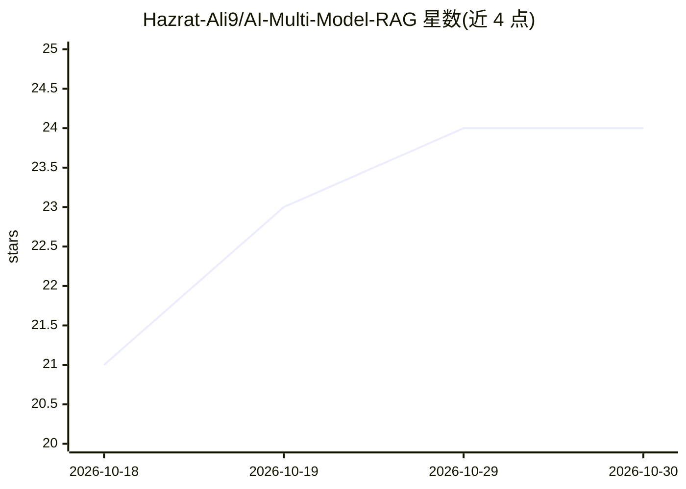

# Hazrat-Ali9/AI-Multi-Model-RAG

⭐ 24 · 推送 2026-03-13 · [GitHub](https://github.com/Hazrat-Ali9/AI-Multi-Model-RAG) · [官网](https://github.com/Hazrat-Ali9/AI-Multi-Model-RAG) · 个人维护

**多模型 RAG 系统：结合文档检索与多 LLM 生成回答**

用 Python 实现的检索增强生成（RAG）系统：将向量嵌入语义检索、文档检索与多个大语言模型结合，基于检索到的外部知识生成上下文相关的回答，宣称通过集成多模型来减少幻觉、提升事实准确性。架构为模块化流水线（检索、嵌入、生成），技术栈提及 LangChain/LlamaIndex 框架与 FAISS/Pinecone/Chroma 向量数据库。README 未提供安装或运行命令，定位为面向 AI 工程师与研究者的知识问答系统参考实现。

## 筛选速览

| 维度 | 判定 | 备注 |
|---|---|---|
| AI 角色 | `ai-native` | 本体是模型或模型工具 |
| 许可风险 | `none` | — |
| 部署形态 | `None` |  |
| 模型依赖 | — | README 未给出锁定关系 |
| 硬件要求 | — | 无带数字的原话,不猜 |
| 安装摩擦 | `low` | 无编译、无系统依赖或容器化 |
| 成熟度 | — | 结构信号不足 |

## 能力要点

- 文档检索与多 LLM 生成结合的 RAG 流水线
- 向量嵌入语义检索（FAISS/Pinecone/Chroma）
- 模块化架构：检索、嵌入、生成分离
- 基于 Python，技术栈含 LangChain/LlamaIndex、Transformers、PyTorch

## 适用场景

- 搭建研究助手或企业知识问答系统
- 学习 RAG 与多模型集成的实现方式
- 作为 LLM/NLP 项目的参考架构

## 场景标签

`RAG` · 领域:知识与检索

## 证据(README 行号)

> L3: AI-Multi-Model-RAG is an advanced artificial intelligence project that implements a Retrieval-Augmented Generation (
> L29: Generate context-aware answers based on retrieved knowledge

## 星数曲线

2026-10-18 21 → 2026-10-30 24（+3）

---
*卡片 v1 · prompt 1.4 · 生成 2026-10-27 · 置信度 mid · 依据 README sha `df3e24adc059` · [字段定义](../../DATASET.md)*
