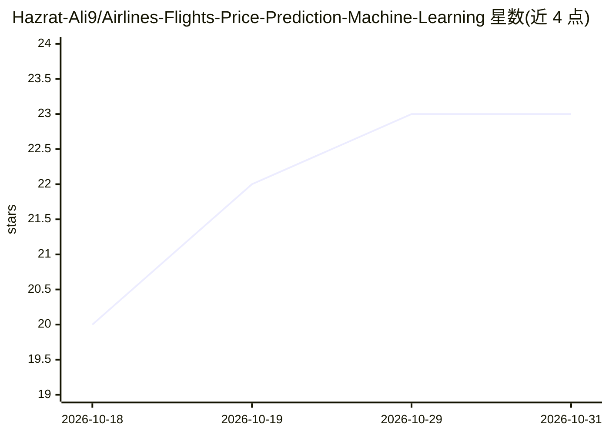

# Hazrat-Ali9/Airlines-Flights-Price-Prediction-Machine-Learning

⭐ 23 · 推送 2026-03-13 · [GitHub](https://github.com/Hazrat-Ali9/Airlines-Flights-Price-Prediction-Machine-Learning) · [官网](https://github.com/Hazrat-Ali9/Airlines-Flights-Price-Prediction-Machine-Learning) · 个人维护

**预测机票价格的机器学习数据科学项目**

基于历史航班数据的机器学习项目：以出发时间、航空公司、飞行时长、出发/到达城市与中转次数等特征，训练回归模型预测机票价格。包含探索性数据分析、缺失值与类别变量处理、特征工程、多模型对比与超参数调优，并以 RMSE、MAE、R² 评估。技术栈为 Python（Pandas、NumPy、Scikit-learn、Matplotlib、Seaborn），在 Jupyter Notebook 中开发，面向数据科学学习者与旅行/航空分析场景。

## 筛选速览

| 维度 | 判定 | 备注 |
|---|---|---|
| AI 角色 | `ai-native` | 本体是模型或模型工具 |
| 许可风险 | `none` | — |
| 部署形态 | `None` |  |
| 模型依赖 | — | README 未给出锁定关系 |
| 硬件要求 | — | 无带数字的原话,不猜 |
| 安装摩擦 | `low` | 无编译、无系统依赖或容器化 |
| 成熟度 | — | 结构信号不足 |

## 能力要点

- 基于多维出行特征的机票价格回归预测
- 多模型对比与超参数调优
- EDA、数据预处理与可视化流程
- 以 RMSE、MAE、R² 指标评估模型

## 适用场景

- 在订票前参考机票价格预测
- 学习回归建模与特征工程的完整流程
- 作为数据科学作品集项目
- 分析航空定价的影响因素

## 场景标签

 · 领域:数据科学/旅行分析

## 证据(README 行号)

> L3: Airlines-Flights-Price-Prediction-Machine-Learning is a data science project that uses machine learning algorithms t
> L17: Implement regression algorithms for flight price prediction

## 星数曲线

2026-10-18 20 → 2026-10-31 23（+3）

---
*卡片 v1 · prompt 1.4 · 生成 2026-10-27 · 置信度 high · 依据 README sha `f9623992500a` · [字段定义](../../DATASET.md)*
