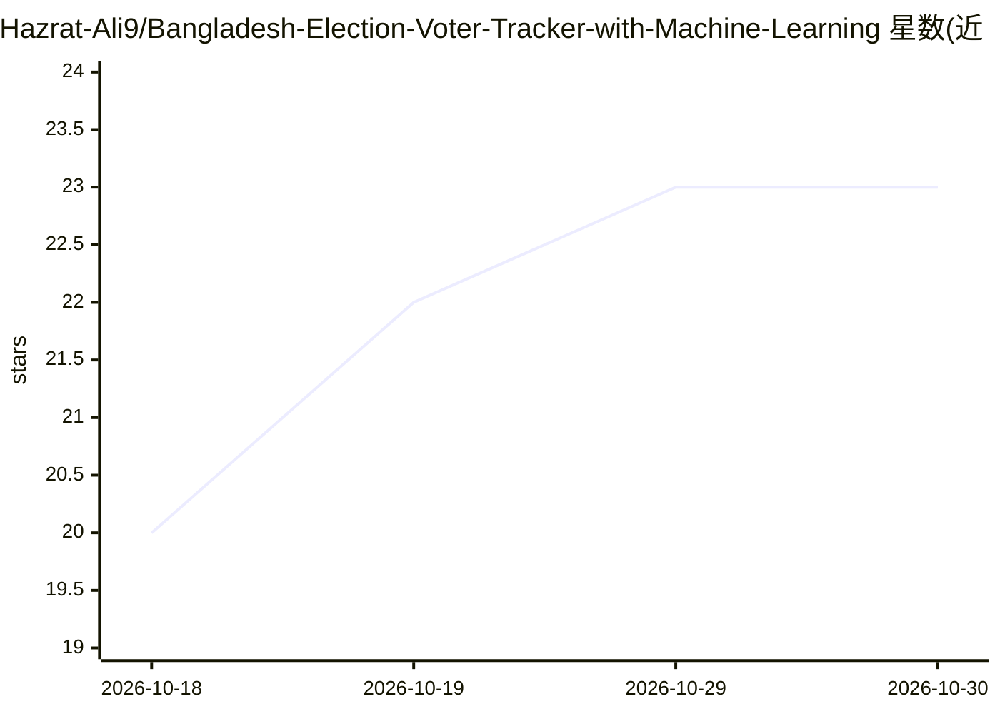

# Hazrat-Ali9/Bangladesh-Election-Voter-Tracker-with-Machine-Learning

⭐ 23 · 推送 2026-03-11 · [GitHub](https://github.com/Hazrat-Ali9/Bangladesh-Election-Voter-Tracker-with-Machine-Learning) · [官网](https://github.com/Hazrat-Ali9/Bangladesh-Election-Voter-Tracker-with-Machine-Learning) · 个人维护

**分析孟加拉国选民与选举数据的机器学习数据科学项目**

面向数据科学家、政治数据研究者和机器学习学生的 Jupyter Notebook 项目：对孟加拉国选民相关选举数据做预处理、特征工程，应用分类与预测模型，识别选民行为模式，并用 Matplotlib/Seaborn 生成选举统计与人口趋势可视化。技术栈为 Python、Pandas、NumPy、Scikit-learn 与 Jupyter Notebook。项目定位为研究导向分析与数据科学作品集示例，README 未提供具体数据来源或安装运行说明。

## 筛选速览

| 维度 | 判定 | 备注 |
|---|---|---|
| AI 角色 | `ai-native` | 本体是模型或模型工具 |
| 许可风险 | `none` | — |
| 部署形态 | `None` |  |
| 模型依赖 | — | README 未给出锁定关系 |
| 硬件要求 | — | 无带数字的原话,不猜 |
| 安装摩擦 | `low` | 无编译、无系统依赖或容器化 |
| 成熟度 | — | 结构信号不足 |

## 能力要点

- 选民数据集的清洗与特征工程预处理管线
- 应用分类与预测模型探索选民行为
- 选举统计与人口/投票趋势图表可视化

## 适用场景

- 研究孟加拉国选举与选民行为模式
- 政治数据研究的学术分析参考
- 机器学习学生的作品集项目

## 场景标签

`数据分析` · 领域:效率与自动化

## 证据(README 行号)

> L7: Bangladesh-Election-Voter-Tracker-with-Machine-Learning is a data science and machine learning project designed to a
> L21: Apply classification and predictive models

## 星数曲线

2026-10-18 20 → 2026-10-30 23（+3）

---
*卡片 v1 · prompt 1.4 · 生成 2026-10-27 · 置信度 mid · 依据 README sha `9f4c8437c2ea` · [字段定义](../../DATASET.md)*
