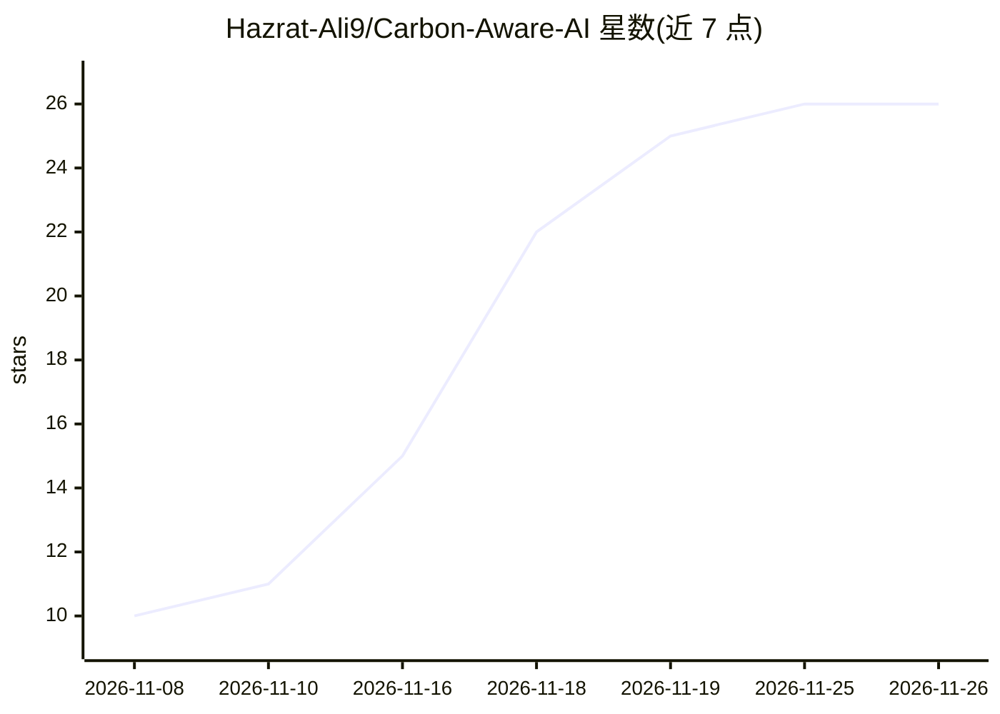

# Hazrat-Ali9/Carbon-Aware-AI

⭐ 26 · 推送 2026-08-28 · [GitHub](https://github.com/Hazrat-Ali9/Carbon-Aware-AI) · [官网](https://github.com/Hazrat-Ali9/Carbon-Aware-AI) · 个人维护

**可持续 AI 研究项目：降低 AI 训练推理的能耗与碳排放**

研究型项目，探索在 AI 开发与部署生命周期中纳入碳强度、能耗、模型效率、硬件利用率与智能调度。研究领域包括碳感知机器学习、碳感知调度（按电网碳强度安排工作负载）、量化/蒸馏/剪枝等绿色模型优化、硬件感知 AI 及训练推理碳排放追踪。README 仅列出潜在技术栈（Python、PyTorch/TensorFlow、CodeCarbon 等）与评估指标体系，未提供安装命令或可运行代码。目标读者为可持续 AI 方向的研究者与开发者。

## 筛选速览

| 维度 | 判定 | 备注 |
|---|---|---|
| AI 角色 | `ai-knowledge` | 知识聚合/清单类 |
| 许可风险 | `none` | — |
| 部署形态 | `None` |  |
| 模型依赖 | — | README 未给出锁定关系 |
| 硬件要求 | — | 无带数字的原话,不猜 |
| 安装摩擦 | `low` | 无编译、无系统依赖或容器化 |
| 成熟度 | — | 结构信号不足 |

## 能力要点

- 碳感知调度：按电网碳强度决定 AI 工作负载执行时机与位置
- 绿色模型优化：量化、知识蒸馏、稀疏化、轻量架构
- AI 碳足迹追踪：训练排放估算与推理能耗测量
- 评估指标覆盖模型质量、能耗、碳排、硬件利用率

## 适用场景

- 研究降低模型训练与推理能耗的优化方法
- 探索按电网碳强度调度 AI 工作负载的方案
- 建立 AI 系统的能源与碳排放度量体系

## 场景标签

 · 领域:可持续计算/AI 能效研究

## 证据(README 行号)

> L3: **Carbon-Aware-AI** is an advanced research project focused on building **environmentally responsible, energy-effici
> L5: As AI models become increasingly computationally intensive, their energy consumption and associated carbon footprint

## 星数曲线

2026-11-08 10 → 2026-11-26 26（+16）

---
*卡片 v1 · prompt 1.4 · 生成 2026-11-18 · 置信度 mid · 依据 README sha `05ed27289485` · [字段定义](../../DATASET.md)*
