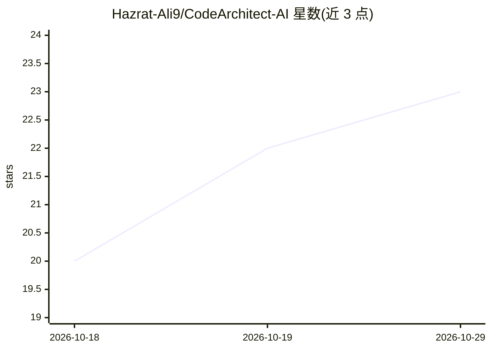

# Hazrat-Ali9/CodeArchitect-AI

⭐ 23 · 推送 2026-03-13 · [GitHub](https://github.com/Hazrat-Ali9/CodeArchitect-AI) · [官网](https://github.com/Hazrat-Ali9/CodeArchitect-AI) · 个人维护

**AI 辅助软件架构设计与代码结构生成的平台**

面向软件开发者的 AI 平台：生成模块化项目模板、建议架构模式（MVC/微服务/分层）、推荐设计最佳实践、进行代码分析并提出结构与性能优化建议，并含自动化项目脚手架等生产力工具。技术栈声明为 Python/JavaScript、TensorFlow/PyTorch、Node.js/Django/FastAPI、React。README 为项目愿景与功能描述，未给出安装运行命令、模型来源或实现细节。

## 筛选速览

| 维度 | 判定 | 备注 |
|---|---|---|
| AI 角色 | `ai-native` | 本体是模型或模型工具 |
| 许可风险 | `none` | — |
| 部署形态 | `None` |  |
| 模型依赖 | — | README 未给出锁定关系 |
| 硬件要求 | — | 无带数字的原话,不猜 |
| 安装摩擦 | `low` | 无编译、无系统依赖或容器化 |
| 成熟度 | — | 结构信号不足 |

## 能力要点

- 自动建议软件架构结构并生成模块化项目模板
- 支持 MVC、微服务、分层等架构模式
- 代码分析：检测架构改进点并推荐优化
- 自动化项目脚手架与智能代码建议

## 适用场景

- 让 AI 建议项目的架构模式与模块结构
- 生成可扩展的前后端项目模板
- 分析现有代码的结构优化空间

## 场景标签

`代码生成` · 领域:编码与开发

## 证据(README 行号)

> L3: CodeArchitect-AI is an advanced AI-powered platform designed to assist developers in designing, structuring, and opt
> L11: Automatically suggest software architecture structures

## 星数曲线

2026-10-18 20 → 2026-10-29 23（+3）

---
*卡片 v1 · prompt 1.4 · 生成 2026-10-27 · 置信度 low · 依据 README sha `41ebbdb7fcc1` · [字段定义](../../DATASET.md)*
