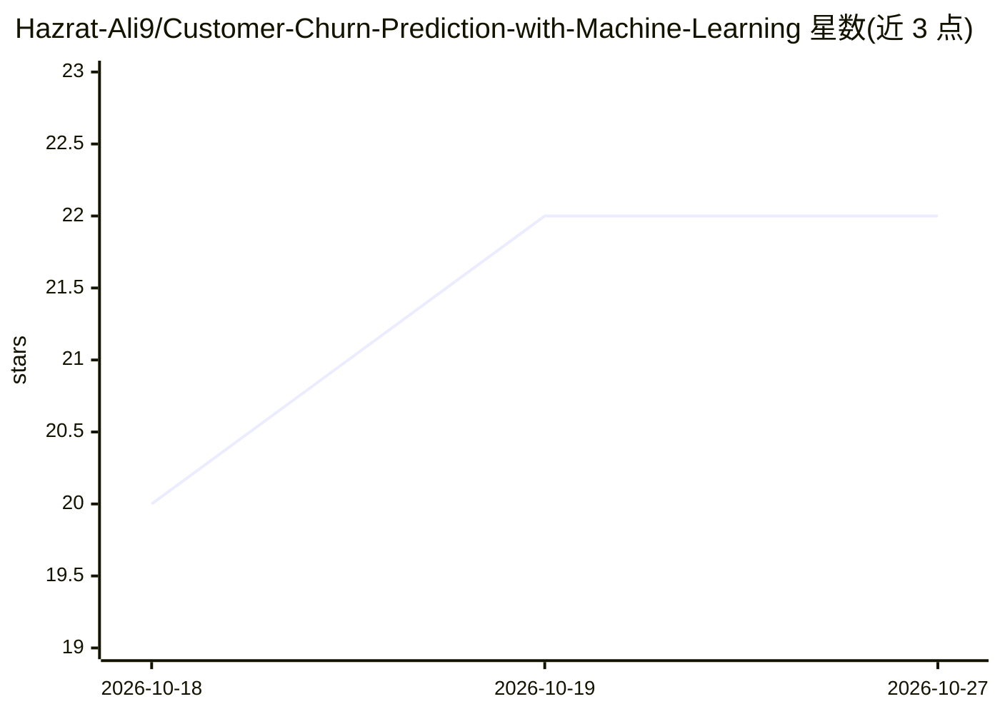

# Hazrat-Ali9/Customer-Churn-Prediction-with-Machine-Learning

⭐ 22 · 推送 2026-03-11 · [GitHub](https://github.com/Hazrat-Ali9/Customer-Churn-Prediction-with-Machine-Learning) · [官网](https://github.com/Hazrat-Ali9/Customer-Churn-Prediction-with-Machine-Learning) · 个人维护

**用机器学习预测客户流失的 Jupyter 数据科学项目**

以 Jupyter Notebook 形式实现的数据科学项目：读取历史客户数据，进行缺失值处理、类别变量编码、特征工程与归一化，训练多种分类算法预测客户流失概率，并通过准确率、精确率、召回率、F1 与混淆矩阵对比模型表现。同时提供客户画像与流失趋势的可视化分析。技术栈为 Python、Pandas、NumPy、Scikit-learn、Matplotlib、Seaborn，面向数据科学家、商业分析与机器学习学习者。README 未提供具体安装命令或数据集说明。

## 筛选速览

| 维度 | 判定 | 备注 |
|---|---|---|
| AI 角色 | `ai-native` | 本体是模型或模型工具 |
| 许可风险 | `none` | — |
| 部署形态 | `None` |  |
| 模型依赖 | — | README 未给出锁定关系 |
| 硬件要求 | — | 无带数字的原话,不猜 |
| 安装摩擦 | `low` | 无编译、无系统依赖或容器化 |
| 成熟度 | — | 结构信号不足 |

## 能力要点

- 多种分类算法实现流失概率预测与模型对比
- 含缺失值处理、类别编码、特征工程的预处理流程
- 准确率/精确率/召回率/F1/混淆矩阵评估
- 客户趋势与行为的可视化分析

## 适用场景

- 分析历史客户数据识别潜在流失客户
- 作为数据科学/机器学习学习与作品集项目
- 为业务留存与营销策略提供分析参考

## 场景标签

 · 领域:数据分析/机器学习

## 证据(README 行号)

> L7: Customer-Churn-Prediction-with-Machine-Learning is a data science project focused on predicting whether customers ar
> L21: Implement classification algorithms to predict churn probability

## 星数曲线

2026-10-18 20 → 2026-10-27 22（+2）

---
*卡片 v1 · prompt 1.4 · 生成 2026-10-27 · 置信度 high · 依据 README sha `d5a20c3a06ec` · [字段定义](../../DATASET.md)*
