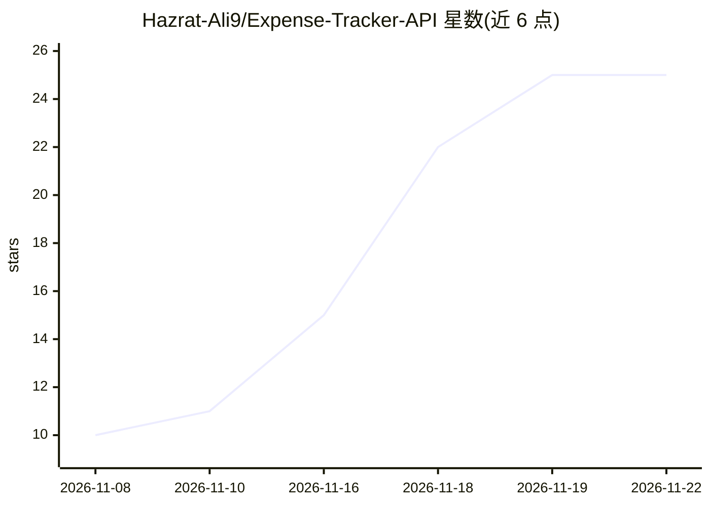

# Hazrat-Ali9/Expense-Tracker-API

⭐ 25 · Python · 推送 2026-11-19 · [GitHub](https://github.com/Hazrat-Ali9/Expense-Tracker-API) · [官网](https://github.com/Hazrat-Ali9/Expense-Tracker-API) · 个人维护

**个人收支记账 REST API 后端：FastAPI + PostgreSQL**

基于 FastAPI、SQLAlchemy、PostgreSQL、Pydantic 与 JWT 的个人收支记账后端：提供用户注册（Argon2 哈希）、OAuth2 兼容登录、带过期时间的 JWT 令牌，以及收支流水的增删改查与按类型/类别/金额区间过滤；所有查询限定在已认证用户范围内，隔离用户数据。提供 Docker Compose 开发环境、Render Blueprint 部署配置、六个 pytest 用例与 /docs 交互文档。README 未描述任何 AI 功能，与仓库 ai 主题标签不对应。

## 筛选速览

| 维度 | 判定 | 备注 |
|---|---|---|
| AI 角色 | `ai-enhanced` | 去掉 AI 部分产品仍成立 |
| 许可风险 | `none` | — |
| 部署形态 | `self-host` | docker 或自建部署 |
| 模型依赖 | — | README 未给出锁定关系 |
| 硬件要求 | — | 无带数字的原话,不猜 |
| 安装摩擦 | `low` | 无编译、无系统依赖或容器化 |
| 成熟度 | — | 结构信号不足 |

## 能力要点

- JWT 认证下的收支流水 CRUD 与多条件过滤（类型/类别/金额区间）
- 查询按用户隔离，防止越权访问他人数据
- Docker Compose 一键启动 API 与 PostgreSQL
- render.yaml 定义 Render 部署（Web 服务 + 托管 PostgreSQL）

## 适用场景

- 为记账类前端/移动应用提供后端 API
- 学习 FastAPI + JWT 认证的示例工程
- 部署到 Render 搭建个人记账服务

## 场景标签

 · 领域:个人财务/Web 后端

## 证据(README 行号)

> L3: A production-ready personal expense tracker built with FastAPI, SQLAlchemy,
> L52: Prerequisites: Python 3.12+ and a PostgreSQL database.

## 星数曲线

2026-11-08 10 → 2026-11-22 25（+15）

---
*卡片 v1 · prompt 1.4 · 生成 2026-11-18 · 置信度 low · 依据 README sha `541850d04977` · [字段定义](../../DATASET.md)*
