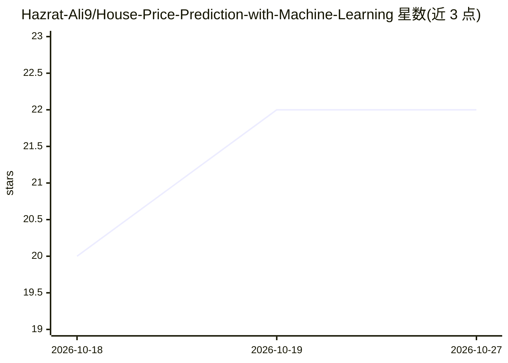

# Hazrat-Ali9/House-Price-Prediction-with-Machine-Learning

⭐ 22 · 推送 2026-03-11 · [GitHub](https://github.com/Hazrat-Ali9/House-Price-Prediction-with-Machine-Learning) · [官网](https://github.com/Hazrat-Ali9/House-Price-Prediction-with-Machine-Learning) · 个人维护

**用回归算法预测房价的数据科学项目**

基于 Python 的房价预测数据科学项目：读取含位置、面积、房间数等特征的历史房源数据，经数据预处理（缺失值/异常值处理、特征工程与归一化）后训练多种回归模型，并用 RMSE、MAE、R² 指标对比评估，同时提供 EDA 与可视化分析。技术栈为 Pandas、NumPy、Scikit-learn、Matplotlib、Seaborn，开发环境为 Jupyter Notebook。README 未给出安装或运行命令，定位为学习与作品集展示项目，面向数据科学学习者与房产市场分析场景。

## 筛选速览

| 维度 | 判定 | 备注 |
|---|---|---|
| AI 角色 | `ai-native` | 本体是模型或模型工具 |
| 许可风险 | `none` | — |
| 部署形态 | `None` |  |
| 模型依赖 | — | README 未给出锁定关系 |
| 硬件要求 | — | 无带数字的原话,不猜 |
| 安装摩擦 | `low` | 无编译、无系统依赖或容器化 |
| 成熟度 | — | 结构信号不足 |

## 能力要点

- 回归算法建模并多模型对比
- 数据预处理管线：缺失值/异常值、特征工程、归一化
- RMSE/MAE/R² 指标评估
- EDA 与市场趋势可视化（Matplotlib/Seaborn）

## 适用场景

- 我想学习端到端的回归建模与模型评估流程
- 分析房产特征与价格的关系及市场趋势
- 作为数据科学作品集项目

## 场景标签

 · 领域:数据科学/房地产分析

## 证据(README 行号)

> L7: House-Price-Prediction-with-Machine-Learning is a data science project that uses machine learning algorithms to pred
> L21: Implement regression algorithms for price prediction

## 星数曲线

2026-10-18 20 → 2026-10-27 22（+2）

---
*卡片 v1 · prompt 1.4 · 生成 2026-10-27 · 置信度 high · 依据 README sha `9004fe549f8c` · [字段定义](../../DATASET.md)*
