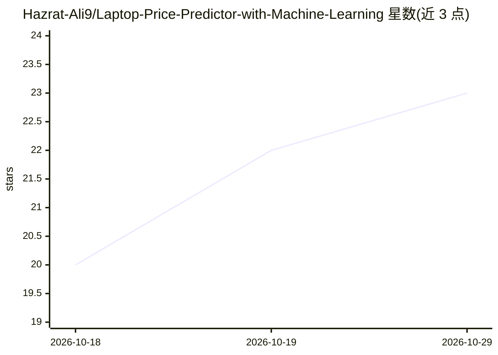

# Hazrat-Ali9/Laptop-Price-Predictor-with-Machine-Learning

⭐ 23 · 推送 2026-03-13 · [GitHub](https://github.com/Hazrat-Ali9/Laptop-Price-Predictor-with-Machine-Learning) · [官网](https://github.com/Hazrat-Ali9/Laptop-Price-Predictor-with-Machine-Learning) · 个人维护

**基于硬件配置预测笔记本电脑价格的机器学习项目**

面向数据科学学习者的 Jupyter Notebook 项目：读取笔记本电脑数据集，基于处理器类型、RAM、存储、屏幕尺寸、GPU、品牌等特征，实现回归算法预测市场价格。项目包含探索性数据分析、缺失值与分类变量处理、特征工程、多模型对比，并用 RMSE、MAE、R² 指标评估与调参。技术栈为 Python 与 Pandas、NumPy、Scikit-learn、Matplotlib、Seaborn，定位为教学与作品集项目；README 未提供安装运行命令。

## 筛选速览

| 维度 | 判定 | 备注 |
|---|---|---|
| AI 角色 | `ai-native` | 本体是模型或模型工具 |
| 许可风险 | `none` | — |
| 部署形态 | `None` |  |
| 模型依赖 | — | README 未给出锁定关系 |
| 硬件要求 | — | 无带数字的原话,不猜 |
| 安装摩擦 | `low` | 无编译、无系统依赖或容器化 |
| 成熟度 | — | 结构信号不足 |

## 能力要点

- 基于处理器、RAM、存储、GPU、品牌等特征的价格回归预测
- 多模型对比与 RMSE/MAE/R² 评估
- 包含 EDA、数据预处理与特征工程流程
- 以 Jupyter Notebook 形式提供

## 适用场景

- 学习回归建模与特征工程的完整流程
- 作为数据科学作品集项目
- 分析硬件配置对笔记本定价的影响

## 场景标签

`教程课程` · 领域:学习与行业

## 证据(README 行号)

> L3: Laptop-Price-Predictor-with-Machine-Learning is a data science project that applies machine learning algorithms to p
> L17: Implement regression algorithms for price prediction

## 星数曲线

2026-10-18 20 → 2026-10-29 23（+3）

---
*卡片 v1 · prompt 1.4 · 生成 2026-10-27 · 置信度 high · 依据 README sha `f51db1bc471a` · [字段定义](../../DATASET.md)*
