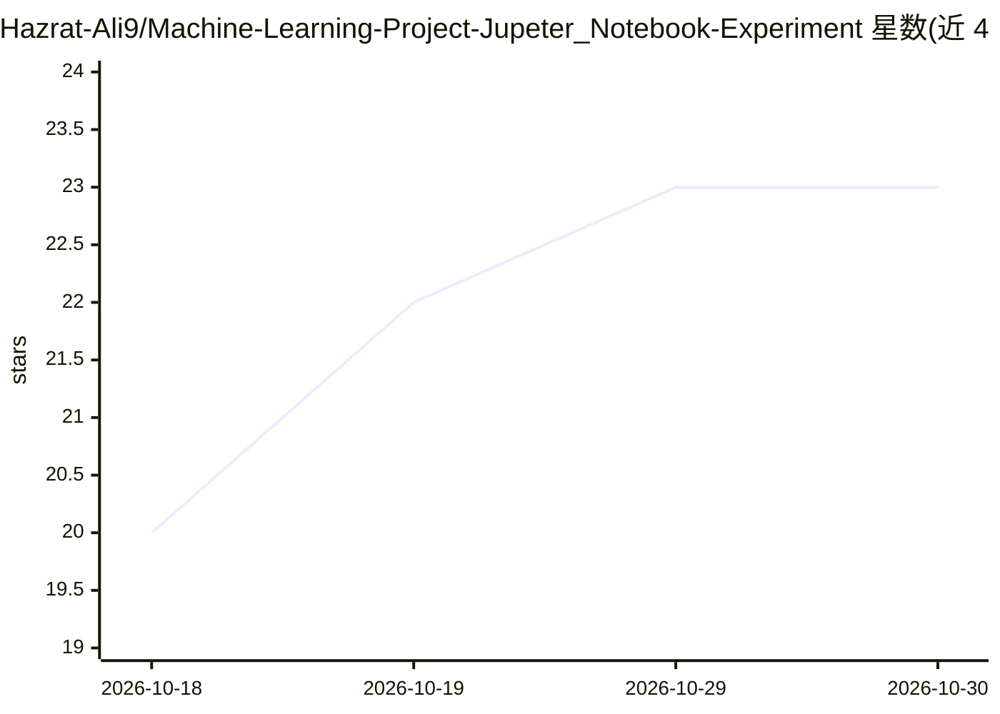

# Hazrat-Ali9/Machine-Learning-Project-Jupeter_Notebook-Experiment

⭐ 23 · 推送 2026-03-13 · [GitHub](https://github.com/Hazrat-Ali9/Machine-Learning-Project-Jupeter_Notebook-Experiment) · [官网](https://github.com/Hazrat-Ali9/Machine-Learning-Project-Jupeter_Notebook-Experiment) · 个人维护

**面向学习者的机器学习实验 Jupyter Notebook 集合**

以 Jupyter Notebook 形式组织的机器学习实验仓库，覆盖多种 ML 算法实现与测试、探索性数据分析、数据清洗与特征工程、模型训练与评估（accuracy/precision/recall 等指标）。技术栈为 Python 与 Pandas、NumPy、Scikit-learn、Matplotlib、Seaborn，在 Jupyter Notebook 环境中运行。面向机器学习学生、数据科学学习者与 AI 研究开发者，定位为分步讲解的动手实验环境与研究/作品集素材。

## 筛选速览

| 维度 | 判定 | 备注 |
|---|---|---|
| AI 角色 | `ai-knowledge` | 知识聚合/清单类 |
| 许可风险 | `none` | — |
| 部署形态 | `None` |  |
| 模型依赖 | — | README 未给出锁定关系 |
| 硬件要求 | — | 无带数字的原话,不猜 |
| 安装摩擦 | `low` | 无编译、无系统依赖或容器化 |
| 成熟度 | — | 结构信号不足 |

## 能力要点

- 多种 ML 算法的实现与跨数据集性能对比
- 探索性数据分析与统计/特征探索
- 数据清洗、特征工程与归一化的预处理流程
- 以 accuracy/precision/recall 等指标做模型评估

## 适用场景

- 分步学习机器学习算法与预处理技术
- 在数据集上做 EDA 与模型对比实验
- 作为作品集或研究实验素材

## 场景标签

`教程课程` · 领域:学习与行业

## 证据(README 行号)

> L3: Machine-Learning-Project-Jupyter_Notebook-Experiment is a collection of machine learning experiments, data science w
> L5: The project focuses on learning by experimentation, allowing researchers, students, and developers to explore machin

## 星数曲线

2026-10-18 20 → 2026-10-30 23（+3）

---
*卡片 v1 · prompt 1.4 · 生成 2026-10-27 · 置信度 high · 依据 README sha `0a62293ffa42` · [字段定义](../../DATASET.md)*
