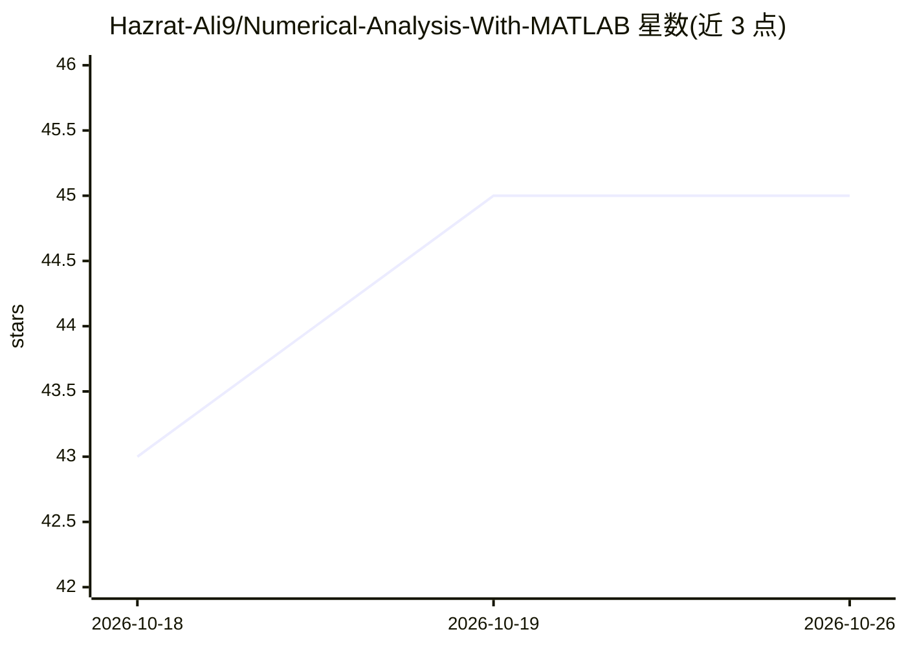

# Hazrat-Ali9/Numerical-Analysis-With-MATLAB

⭐ 45 · MIT · 推送 2025-12-31 · [GitHub](https://github.com/Hazrat-Ali9/Numerical-Analysis-With-MATLAB) · [官网](https://github.com/Hazrat-Ali9/Numerical-Analysis-With-MATLAB) · 个人维护

**MATLAB 数值分析算法代码集：欧拉法、Simpson、龙格-库塔等**

由个人（软件工程专业学生）发布的 MATLAB 数值方法代码片段集合，README 以注释代码形式给出 5 个算法：欧拉法解 ODE、Simpson 3/8 与 1/3 积分、梯形法积分、四阶 Runge-Kutta 解 ODE。每段代码包含初始化、迭代过程与 printf 输出。未提供安装说明、依赖声明、运行方式或文档结构，仅适合作学习参考片段。

## 筛选速览

| 维度 | 判定 | 备注 |
|---|---|---|
| AI 角色 | `ai-knowledge` | 知识聚合/清单类 |
| 许可风险 | `permissive` | MIT |
| 部署形态 | `None` |  |
| 模型依赖 | — | README 未给出锁定关系 |
| 硬件要求 | — | 无带数字的原话,不猜 |
| 安装摩擦 | `low` | 无编译、无系统依赖或容器化 |
| 成熟度 | — | 结构信号不足 |

## 能力要点

- 欧拉法与四阶 Runge-Kutta 求解常微分方程
- Simpson 1/3、Simpson 3/8 与梯形法数值积分实现
- 以 MATLAB 脚本片段形式给出，含逐行注释

## 适用场景

- 学习经典数值方法的 MATLAB 实现写法
- 课程作业或学术项目中参考积分与 ODE 算法代码

## 场景标签

`教程课程` · 领域:学习与行业

## 证据(README 行号)

> L7: # Eular Method : Number 1
> L86: # Runge Kutta : 5

## 星数曲线

2026-10-18 43 → 2026-10-26 45（+2）

---
*卡片 v1 · prompt 1.4 · 生成 2026-10-25 · 置信度 mid · 依据 README sha `1fad15bbf2f8` · [字段定义](../../DATASET.md)*
