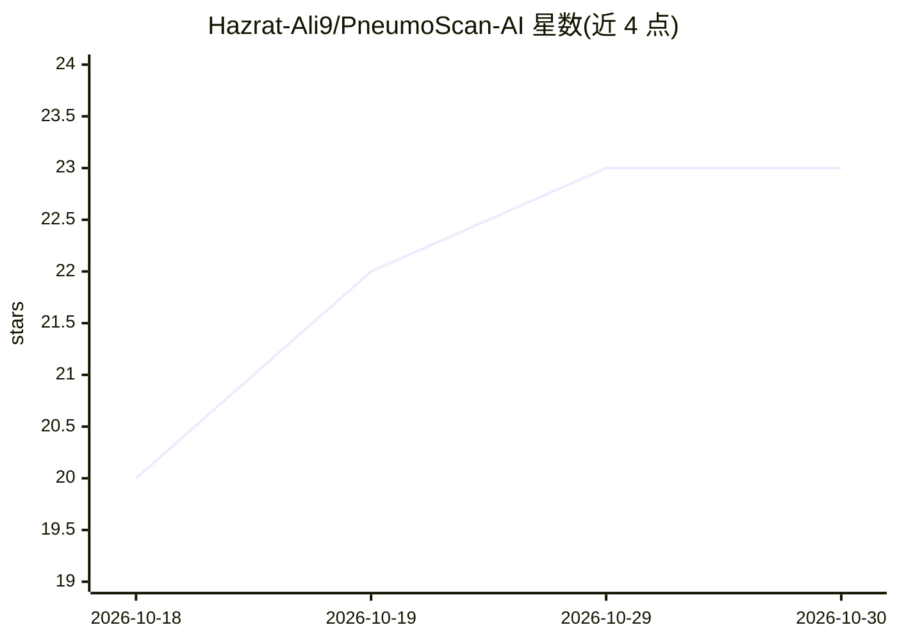

# Hazrat-Ali9/PneumoScan-AI

⭐ 23 · Jupyter Notebook · MIT · 推送 2026-05-08 · [GitHub](https://github.com/Hazrat-Ali9/PneumoScan-AI) · [官网](https://github.com/Hazrat-Ali9/PneumoScan-AI) · 个人维护

**胸部 X 光片肺炎检测与肺部异常分割的深度学习项目**

基于 U-Net（ResNet50 编码器，迁移学习）的医学影像分割项目，从胸部 X 光片中识别肺部异常并检测肺炎。使用 TensorFlow tf.data 与 Keras Sequence 构建内存高效数据管道，采用 BCE-Dice 混合损失应对类别不平衡（README 称 Dice 0.88 / IoU 0.82），OpenCV 后处理生成边界框与置信度，并以 Streamlit 部署网页界面上传 X 光并显示诊断叠加。面向医疗 AI 研究者、深度学习开发者与医学影像学习者，通过 conda 环境从源码运行，数据集需自行下载。

## 筛选速览

| 维度 | 判定 | 备注 |
|---|---|---|
| AI 角色 | `ai-native` | 本体是模型或模型工具 |
| 许可风险 | `permissive` | MIT |
| 部署形态 | `library` | 以包/库形式分发 |
| 模型依赖 | — | README 未给出锁定关系 |
| 硬件要求 | — | 无带数字的原话,不猜 |
| 安装摩擦 | `low` | 无编译、无系统依赖或容器化 |
| 成熟度 | — | 结构信号不足 |

## 能力要点

- U-Net + 预训练 ResNet50 编码器的肺部异常分割
- BCE-Dice 混合损失应对医学影像类别不平衡
- OpenCV 后处理生成边界框与置信度
- Streamlit 网页界面上传 X 光并获得即时诊断叠加

## 适用场景

- 训练并评估胸部 X 光肺炎检测模型
- 上传 X 光片到 Streamlit 界面查看异常分割与置信度
- 作为医疗影像 AI 的学习与作品集项目

## 场景标签

`图像视频处理` `目标检测` · 领域:感知与多模态

## 证据(README 行号)

> L5: Automated Lung Segmentation and Abnormality Detection in Chest X-rays using U-Net with ResNet50 Backbone
> L50: PneumoScan-AI is an AI-powered medical imaging project designed to detect pneumonia from chest X-ray images using d

## 星数曲线

2026-10-18 20 → 2026-10-30 23（+3）

---
*卡片 v1 · prompt 1.4 · 生成 2026-10-27 · 置信度 mid · 依据 README sha `3518b08dba89` · [字段定义](../../DATASET.md)*
