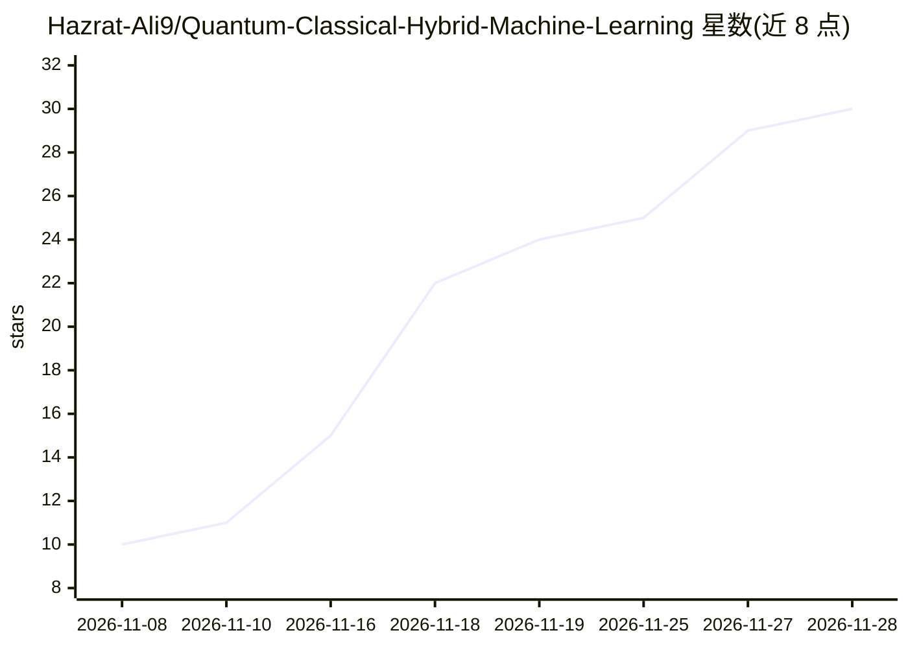

# Hazrat-Ali9/Quantum-Classical-Hybrid-Machine-Learning

⭐ 30 · 推送 2026-08-27 · [GitHub](https://github.com/Hazrat-Ali9/Quantum-Classical-Hybrid-Machine-Learning) · [官网](https://github.com/Hazrat-Ali9/Quantum-Classical-Hybrid-Machine-Learning) · 个人维护

**量子-经典混合机器学习的研究探索项目（提案型）**

一个面向量子机器学习的研究项目：探索参数化量子电路、量子特征映射、变分量子算法与经典神经网络结合的混合架构，规划联合优化量子与经典参数、分类/回归任务评测及经典与量子的基准对比。README 给出拟采用的技术栈（Qiskit/PennyLane/TensorFlow Quantum/PyTorch 等）与研究方向清单，但可见部分未提供安装命令、可运行代码或实验结果；末行声明量子优势论断需通过受控基准验证。

## 筛选速览

| 维度 | 判定 | 备注 |
|---|---|---|
| AI 角色 | `ai-native` | 本体是模型或模型工具 |
| 许可风险 | `none` | — |
| 部署形态 | `None` |  |
| 模型依赖 | — | README 未给出锁定关系 |
| 硬件要求 | — | 无带数字的原话,不猜 |
| 安装摩擦 | `low` | 无编译、无系统依赖或容器化 |
| 成熟度 | — | 结构信号不足 |

## 能力要点

- 规划量子电路+经典神经网络的混合架构与联合参数优化
- 列出变分量子电路、量子特征映射、参数位移梯度等研究主题
- 给出拟用技术栈（Qiskit/PennyLane/TensorFlow Quantum/PyTorch）
- 附量子优势需受控基准验证的研究性声明

## 适用场景

- 了解量子-经典混合机器学习的研究框架与方向清单
- 作为量子 AI 课题的选题与路线参考

## 场景标签

 · 领域:量子计算/机器学习

## 证据(README 行号)

> L5: The project investigates how **parameterized quantum circuits, quantum feature maps, variational quantum algorithms,
> L42:  * Compare classical and hybrid architectures
> L79: * 🎯 Classification Accuracy

## 星数曲线

2026-11-08 10 → 2026-11-28 30（+20）

---
*卡片 v1 · prompt 1.4 · 生成 2026-11-18 · 置信度 mid · 依据 README sha `f2da8b081604` · [字段定义](../../DATASET.md)*
