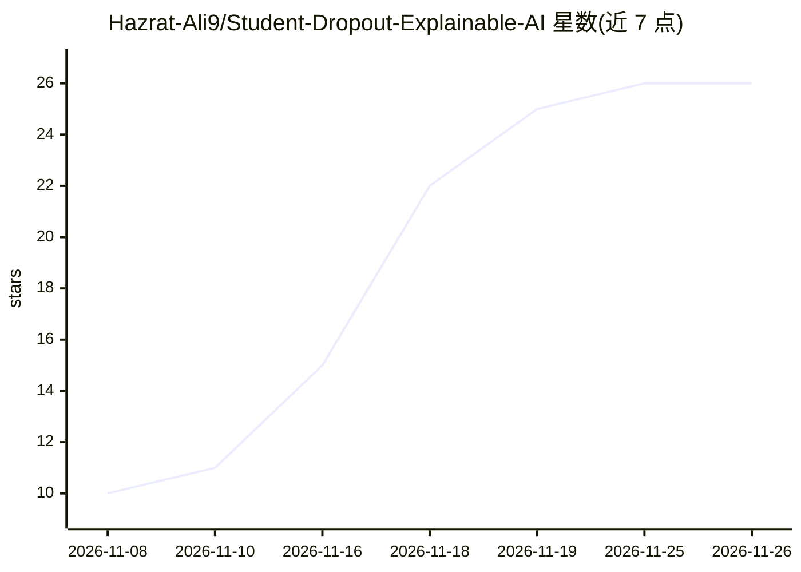

# Hazrat-Ali9/Student-Dropout-Explainable-AI

⭐ 26 · 推送 2026-08-31 · [GitHub](https://github.com/Hazrat-Ali9/Student-Dropout-Explainable-AI) · [官网](https://github.com/Hazrat-Ali9/Student-Dropout-Explainable-AI) · 个人维护

**用机器学习与可解释 AI 预测并解释学生辍学风险的研究项目**

面向教育数据挖掘的研究项目设计：用 Logistic Regression、随机森林、XGBoost 等多种机器学习模型预测学生辍学风险，并用 SHAP、LIME、置换重要性、反事实解释等 XAI 技术输出全局与个体层面的风险归因，供教育决策者设计干预。README 描述了候选模型、特征来源（UCI 辍学数据集 4,424 条记录 36 特征）、评估指标（Recall、Macro-F1、公平性分组指标）与潜在技术栈（Python、Scikit-learn、Streamlit、FastAPI 等），但均为设计性描述，未见已实现的安装命令或代码运行说明。

## 筛选速览

| 维度 | 判定 | 备注 |
|---|---|---|
| AI 角色 | `ai-native` | 本体是模型或模型工具 |
| 许可风险 | `none` | — |
| 部署形态 | `None` |  |
| 模型依赖 | — | README 未给出锁定关系 |
| 硬件要求 | — | 无带数字的原话,不猜 |
| 安装摩擦 | `low` | 无编译、无系统依赖或容器化 |
| 成熟度 | — | 结构信号不足 |

## 能力要点

- 结合辍学预测与 SHAP/LIME 等可解释性技术，输出个体层面的风险归因
- 列出候选模型（XGBoost/LightGBM/CatBoost 等）与不平衡多分类评估指标
- 以 UCI Predict Students' Dropout 数据集（4,424 条、36 特征）为基准数据源
- 讨论公平性与偏差分析作为项目目标之一

## 适用场景

- 高校构建辍学早期预警系统的方案参考
- 教育研究者复现可解释辍工预测的选题与指标设计
- 需要向决策者解释风险归因而非仅输出概率的场景

## 场景标签

 · 领域:教育/机器学习研究

## 证据(README 行号)

> L3: **Student-Dropout-Explainable-AI** is an advanced **Machine Learning, Educational Data Mining, and Explainable Artif
> L39: * **SHAP**

## 星数曲线

2026-11-08 10 → 2026-11-26 26（+16）

---
*卡片 v1 · prompt 1.4 · 生成 2026-11-18 · 置信度 mid · 依据 README sha `adf883d8101a` · [字段定义](../../DATASET.md)*
