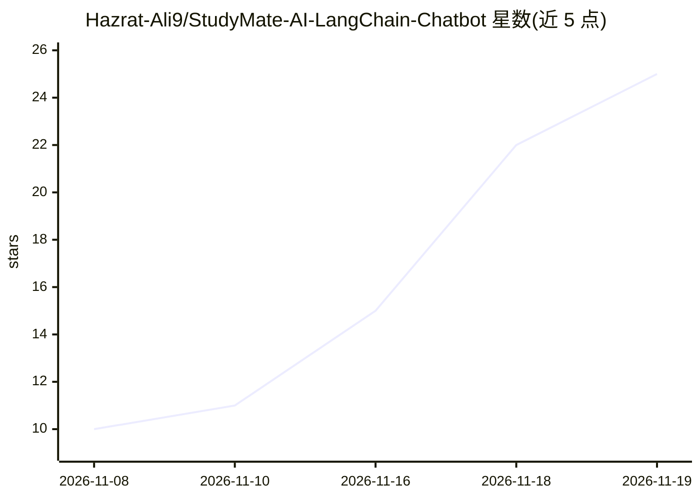

# Hazrat-Ali9/StudyMate-AI-LangChain-Chatbot

⭐ 25 · Python · 推送 2026-11-17 · [GitHub](https://github.com/Hazrat-Ali9/StudyMate-AI-LangChain-Chatbot) · [官网](https://github.com/Hazrat-Ali9/StudyMate-AI-LangChain-Chatbot) · 个人维护

**面向初学者的教育问答聊天机器人，LangChain 构建多路由并发管道**

基于 Streamlit 与 LangChain Expression Language 构建的教育助手聊天机器人。通过关键词规则和 RunnableBranch 将问题路由到编程、数学或通用三条提示管道；RunnableParallel 并发生成详细回答、简短摘要和关键词；使用 Pydantic BaseModel 与 with_structured_output 严格模式输出验证过的结构化结果（answer/summary/confidence/category/keywords 五字段）。聊天模型接入 Groq，API key 经 .env 配置。安装方式为克隆源码、虚拟环境、pip 安装依赖后以 streamlit run 运行。

## 筛选速览

| 维度 | 判定 | 备注 |
|---|---|---|
| AI 角色 | `ai-native` | 本体是模型或模型工具 |
| 许可风险 | `none` | — |
| 部署形态 | `library` | 以包/库形式分发 |
| 模型依赖 | locked-api |  |
| 硬件要求 | — | 无带数字的原话,不猜 |
| 安装摩擦 | `low` | 无编译、无系统依赖或容器化 |
| 成熟度 | — | 结构信号不足 |

## 能力要点

- RunnableBranch 三路路由：编程/数学/通用提示管道
- RunnableParallel 并发生成回答、摘要与关键词
- Pydantic 严格结构化输出，含二次 model_validate 验证
- Streamlit 聊天界面，带会话历史与 JSON 查看视图

## 适用场景

- 学生学习时提问编程、数学或一般性知识问题
- 获得带摘要、关键词和置信度的结构化回答
- 初学者参考 LangChain LCEL 的路由与并发管道实现

## 场景标签

`聊天机器人` · 领域:对话与助手

## 证据(README 行号)

> L3: StudyMate AI is a beginner-friendly chatbot built with Streamlit and the latest
> L11: - Groq chat model configured through a `.env` file
> L59: `answer`, `summary`, `confidence`, `category`, and `keywords`. The Groq model is

## 星数曲线

2026-11-08 10 → 2026-11-19 25（+15）

---
*卡片 v1 · prompt 1.4 · 生成 2026-11-18 · 置信度 mid · 依据 README sha `4707036df533` · [字段定义](../../DATASET.md)*
