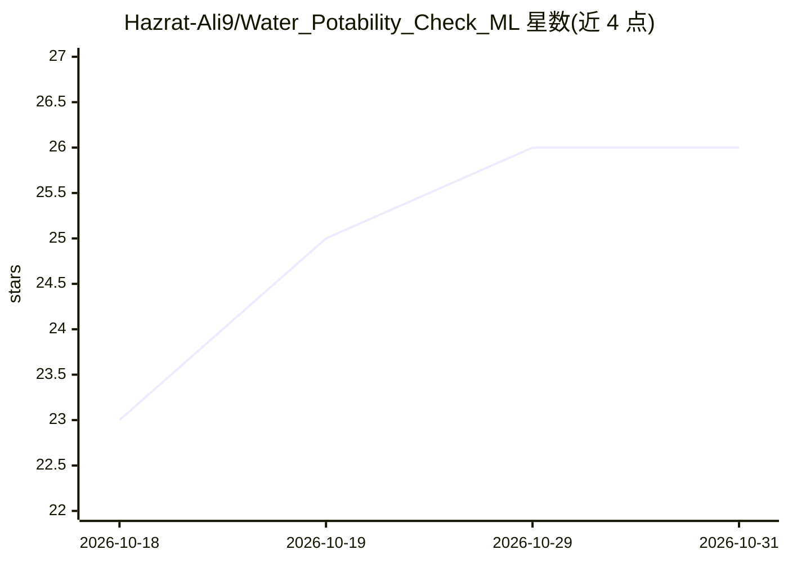

# Hazrat-Ali9/Water_Potability_Check_ML

⭐ 26 · Python · 推送 2026-10-28 · [GitHub](https://github.com/Hazrat-Ali9/Water_Potability_Check_ML) · [官网](https://huggingface.co/spaces/Hazrat-Ali9/Water_Potability_Check_ML) · 个人维护

**机器学习预测饮用水可饮用性的分类项目**

基于 Kaggle 水质数据集的分类项目：读取 pH、硬度、溶解物、浊度等 9 项理化指标，预测水是否可饮用（二分类）。流程包括缺失值处理、标准化与训练集划分，对比 Logistic Regression、Random Forest、Gradient Boosting、KNN 等多种算法，最终选用带多项式特征工程的 Logistic Regression。提供 Colab 测试笔记本，面向学习与数据分析用途。

## 筛选速览

| 维度 | 判定 | 备注 |
|---|---|---|
| AI 角色 | `ai-native` | 本体是模型或模型工具 |
| 许可风险 | `none` | — |
| 部署形态 | `None` |  |
| 模型依赖 | — | README 未给出锁定关系 |
| 硬件要求 | — | 无带数字的原话,不猜 |
| 安装摩擦 | `low` | 无编译、无系统依赖或容器化 |
| 成熟度 | — | 结构信号不足 |

## 能力要点

- 基于 Kaggle 水质数据集的 9 项理化指标二分类预测
- 对比 LR/RF/GB/KNN 等多种算法并用 Accuracy/Precision/Recall/F1 评估
- 最终模型为带多项式特征工程的 Logistic Regression
- 提供 Colab 测试笔记本

## 适用场景

- 根据水质理化指标判断饮用水是否安全
- 作为机器学习分类流程的学习与实验项目
- 在 Colab 中复现训练与评估过程

## 场景标签

 · 领域:数据科学/公共健康

## 证据(README 行号)

> L7: This project predicts the **potability of Water** using machine learning models.
> L22: - Target: **Potability** (0 = Not Potable, 1 = Potable)

## 星数曲线

2026-10-18 23 → 2026-10-31 26（+3）

---
*卡片 v1 · prompt 1.4 · 生成 2026-10-27 · 置信度 high · 依据 README sha `91976afec710` · [字段定义](../../DATASET.md)*
