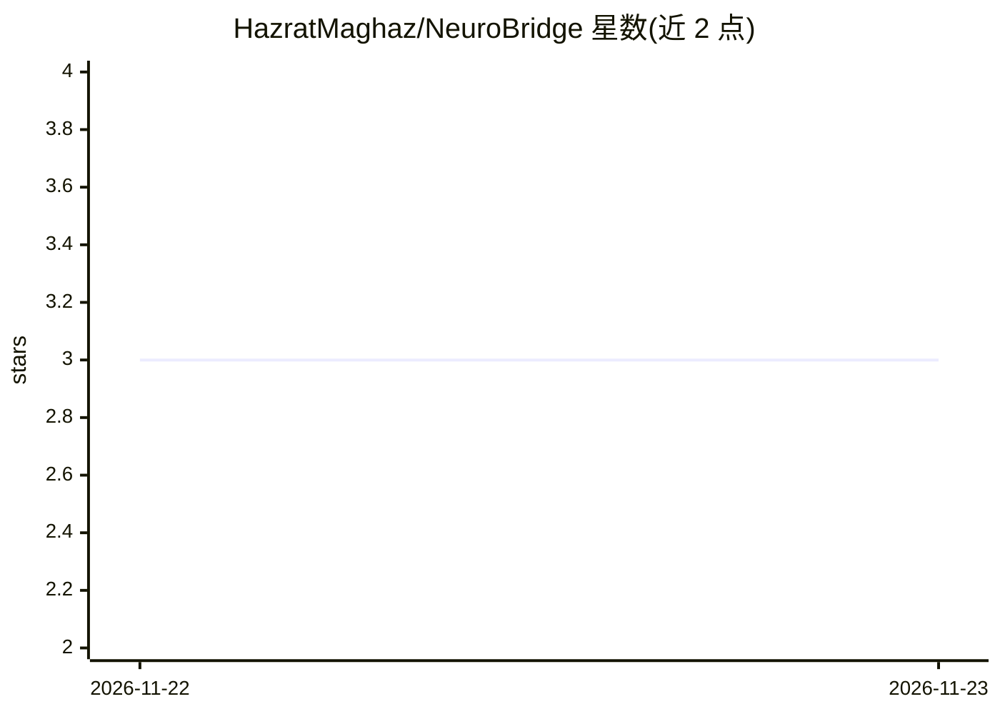

# HazratMaghaz/NeuroBridge

⭐ 3 · Python · NOASSERTION · 推送 2026-11-14 · [GitHub](https://github.com/HazratMaghaz/NeuroBridge) · 个人维护

**面向科研者的胶质瘤组织病理×基因表达多模态复现 CLI**

围绕修正后的研究分析脚本提供的命令行工具，用于 TCGA-GBM 与 TCGA-LGG 项目组区分的回顾性研究：接收已 prepared 的患者级特征（表达矩阵、split manifest、嵌入），提供 validate/run 等 CLI 命令执行患者级分类与分子靶点分析，支持 PCA-2 论文设置复现与合成数据冒烟测试。仓库仅分发源码，不含患者数据、原始切片、训练权重或预测结果；声明为研究软件，非诊断应用。

## 筛选速览

| 维度 | 判定 | 备注 |
|---|---|---|
| AI 角色 | `ai-native` | 本体是模型或模型工具 |
| 许可风险 | `permissive` | NOASSERTION |
| 部署形态 | `library` | 以包/库形式分发 |
| 模型依赖 | — | README 未给出锁定关系 |
| 硬件要求 | — | 无带数字的原话,不猜 |
| 安装摩擦 | `medium` | 含编译或系统依赖之一 |
| 成熟度 | — | 结构信号不足 |

## 能力要点

- CLI 提供 demo/validate/run 多阶段流程（classification/core/external/full）
- 输入验证检查路径、患者/split 一致性与特征维度
- 提供 PCA-2 论文复现配置与合成数据冒烟测试
- 仓库仅含源码，不含数据、权重与历史预测

## 适用场景

- 在合成数据上先验证软件可运行，再接入自有研究数据
- 按 PCA-2 配置复现论文级分析流程
- 对已准备的 TCGA 兼容特征做患者级分类研究

## 场景标签

`科研工具` · 领域:学习与行业

## 证据(README 行号)

> L22: > **NeuroBridge is retrospective research software, not a diagnostic application.** It studies *TCGA-GBM versus TCG
> L101: |`neurobridge run --config FILE --stage classification`|Corrected patient-level classification and representation 
> L130: - **Task definition.** The classification labels encode **TCGA-GBM versus TCGA-LGG project membership**. These are

## 星数曲线

2026-11-22 3 → 2026-11-23 3（+0）

---
*卡片 v1 · prompt 1.4 · 生成 2026-11-22 · 置信度 high · 依据 README sha `1efbaf8832e3` · [字段定义](../../DATASET.md)*
