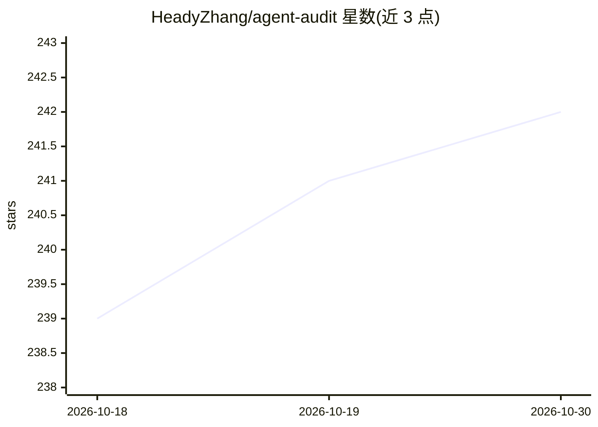

# HeadyZhang/agent-audit

⭐ 242 · Python · MIT · 推送 2026-09-13 · [GitHub](https://github.com/HeadyZhang/agent-audit) · [官网](https://headyzhang.github.io/agent-audit/) · 个人维护

**AI agent 代码静态安全扫描器：检测提示注入、MCP 配置风险**

面向 AI agent 开发者与安全工程师的 Python CLI 静态分析工具：通过工具边界污点追踪（@tool 参数流向 eval/subprocess 等危险 sink）、MCP 配置审计（解析 claude_desktop_config.json，检测未认证服务器、工具投毒、影子工具、rug pull）、三阶段语义凭据检测，提供 66 条规则映射 OWASP Agentic Top 10（2026）全部 10 类。支持 LangChain/CrewAI/AutoGen/AgentScope 特定检测，输出 terminal/json/sarif/markdown，可作 CI 门禁（--fail-on）与基线增量扫描，另有 GitHub Action 与 OpenClaw 技能形式。限制：纯静态分析，污点追踪仅函数内，Python 为主。

## 筛选速览

| 维度 | 判定 | 备注 |
|---|---|---|
| AI 角色 | `ai-ecosystem` | LLM/agent 周边工具 |
| 许可风险 | `permissive` | MIT |
| 部署形态 | `library` | 以包/库形式分发 |
| 模型依赖 | — | README 未给出锁定关系 |
| 硬件要求 | — | 无带数字的原话,不猜 |
| 安装摩擦 | `low` | 无编译、无系统依赖或容器化 |
| 成熟度 | `idea` | |

## 能力要点

- 66 条规则覆盖 OWASP Agentic Top 10（2026）全部 10 类
- 工具边界污点追踪与 MCP 配置审计（投毒/影子工具/rug pull）
- SARIF 输出接入 GitHub Security tab，支持 CI 门禁与基线增量扫描
- 可作为 OpenClaw 技能安装（含 7 条专用规则）

## 适用场景

- agent 代码上线前在 CI 里扫描提示注入与危险 sink
- 审计 mcp.json / claude_desktop_config.json 的凭据泄露与认证缺失
- 安全评审 agent 代码库并输出结构化 SARIF 报告

## 场景标签

`网络安全` · 领域:学习与行业

## 证据(README 行号)

> L24: **Agent Audit** catches these issues before deployment with an analysis core designed for agent workflows today: to
> L39: agent-audit scan ./your-agent-project
> L197: - **MCP configuration auditing** -- Parses `claude_desktop_config.json` and MCP gateway configs to detect unverifi

## 星数曲线

2026-10-18 239 → 2026-10-30 242（+3）

---
*卡片 v1 · prompt 1.4 · 生成 2026-10-22 · 置信度 mid · 依据 README sha `24e7ceaf1f24` · [字段定义](../../DATASET.md)*
