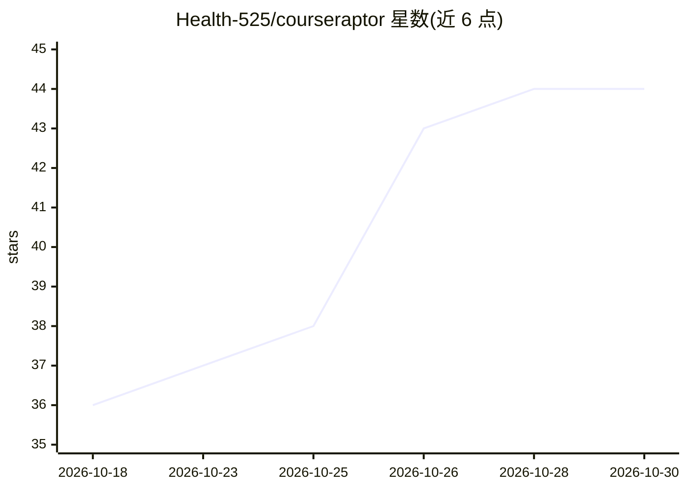

# Health-525/courseraptor

⭐ 44 · TypeScript · MIT · 推送 2026-10-29 · [GitHub](https://github.com/Health-525/courseraptor) · [官网](https://health-525.github.io/courseraptor/) · 个人维护 · 中文 README

**面向大学生的本地优先 AI 学习工作台：课表、待办与知识库一处管理**

面向大学生的本地优先学习工作台：把课表查询、待办截止提醒、今日安排、课程知识库与课程材料（PDF/Word/表格阅读、生成 Word/Excel/PDF/PPT）统一到一个界面，通过自然语言对话操作。AI 对话需要用户自备模型 API Key（默认支持 DeepSeek，可选其他厂商或自定义端点），相关内容会发送到所选模型服务；学习记录保存在本机，无 Key 可运行离线演示。支持网页与终端 TUI 入口，配置后可接入 QQ 机器人与 Obsidian 插件。Windows 提供安装包，macOS/Linux 需源码运行（Node.js 24+）。

## 筛选速览

| 维度 | 判定 | 备注 |
|---|---|---|
| AI 角色 | `ai-native` | 本体是模型或模型工具 |
| 许可风险 | `permissive` | MIT |
| 部署形态 | `desktop` | 安装包/桌面程序 |
| 模型依赖 | locked-api |  |
| 硬件要求 | — | 无带数字的原话,不猜 |
| 安装摩擦 | `low` | 无编译、无系统依赖或容器化 |
| 成熟度 | — | 结构信号不足 |

## 能力要点

- 自然语言查询课表、记录待办、整理今日安排
- 课表导入支持文字/Excel/CSV/PDF/Word/TXT，可导出 SVG/PNG/.ics
- 本地优先数据保存，AI 对话使用用户自备 API Key
- 网页与终端 TUI 入口，可配置接入 QQ 机器人与 Obsidian 插件

## 适用场景

- 问「这周周三在哪上课」并直接记录截止事项
- 结合课表和待办查看当天安排，运行时收到到期提醒
- 按课程沉淀知识点，用费曼学习法、螺旋复习整理复习
- 阅读课程 PDF/Word 并生成 Word、Excel、PDF 或转换成 PPT

## 场景标签

`知识库管理` · 领域:知识与检索

## 证据(README 行号)

> L16: CourseRaptor 把课表查询、截止提醒和课程资料整理放进同一个学习工作台。你可以问「这周周三在哪上课？」，也可以说「记一下，周五下午三点前交实验报告」，或直接在功能大厅查看和管理。
> L65: 1. **配置模型。** 启动应用，在「功能大厅 → 设置 → AI 模型」填写自己的 API Key，保存并检测连接。默认支持 DeepSeek，也可选择其他内置厂商或自定义兼容端点。
> L18: 学习记录保存在本机；正式 AI 对话需要自己的模型 API Key，相关内容会发送到所选模型服务，并可能产生调用费用。没有 Key 也可以先体验离线演示。

## 星数曲线

2026-10-18 36 → 2026-10-30 44（+8）

---
*卡片 v1 · prompt 1.4 · 生成 2026-10-25 · 置信度 high · 依据 README sha `d0a91b8fcfab` · [字段定义](../../DATASET.md)*
