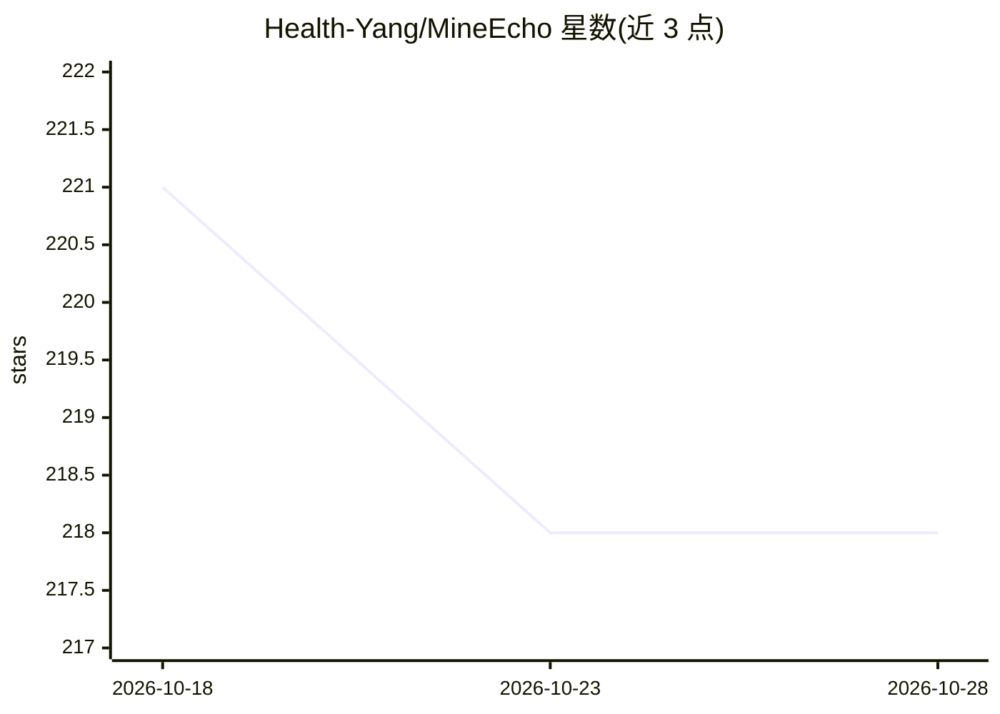

# Health-Yang/MineEcho

⭐ 219 · TypeScript · NOASSERTION · 推送 2026-06-05 · [GitHub](https://github.com/Health-Yang/MineEcho) · 个人维护 · 中文 README

**本地优先的个人 AI 助手记忆操作系统：记忆分层、知识库、技能路由**

面向个人 AI 助手的本地优先框架，核心为运行时记忆与 L0-L3 记忆树（原始记忆块/日/周/月归档）、Wiki++ 知识库（原始文件+AI 维护 wiki 页，向量/BM25/结构化/图四通道检索）、本地技能与注册 AI 应用统一路由，以及含 15 条内置规则的 TokenLess 输出压缩层。后端复用仓库内自带的 OpenClaw Gateway 运行时，模型 API key 需用户自配。提供 Windows 安装包、macOS DMG 与 npm 源码启动三种途径。

## 筛选速览

| 维度 | 判定 | 备注 |
|---|---|---|
| AI 角色 | `ai-ecosystem` | LLM/agent 周边工具 |
| 许可风险 | `none` | NOASSERTION |
| 部署形态 | `desktop` | 安装包/桌面程序 |
| 模型依赖 | — | README 未给出锁定关系 |
| 硬件要求 | — | 无带数字的原话,不猜 |
| 安装摩擦 | `low` | 无编译、无系统依赖或容器化 |
| 成熟度 | — | 结构信号不足 |

## 能力要点

- L0-L3 记忆树与工作/短期/长期双视图，多信号召回加嵌入重排
- Wiki++ 知识库支持向量、BM25、结构化、图四通道检索
- 本地技能与外部 AI 应用注册到同一触发/路由/健康检查面
- TokenLess 压缩含 15 条内置 reducer 规则并本地记录节省指标

## 适用场景

- 搭建能长期记住偏好和历史工作的个人助手
- 把导入的资料组织成可浏览的 wiki 与知识图谱
- 将多个 AI 应用收编为可路由调用的技能并控制上下文成本

## 场景标签

`知识图谱` `RAG` `Agent 记忆` `知识库管理` · 领域:Agent 开发

## 证据(README 行号)

> L7: MineEcho is a source-available, local-first AI assistant framework for building private, extensible assistant workfl
> L70: - Local console and BFF for chat, skills, memory, knowledge base, calendar/meeting helpers, and configuration.

## 星数曲线

2026-10-18 221 → 2026-10-28 218（-3）

---
*卡片 v1 · prompt 1.4 · 生成 2026-10-22 · 置信度 high · 依据 README sha `40ead73252b3` · [字段定义](../../DATASET.md)*
