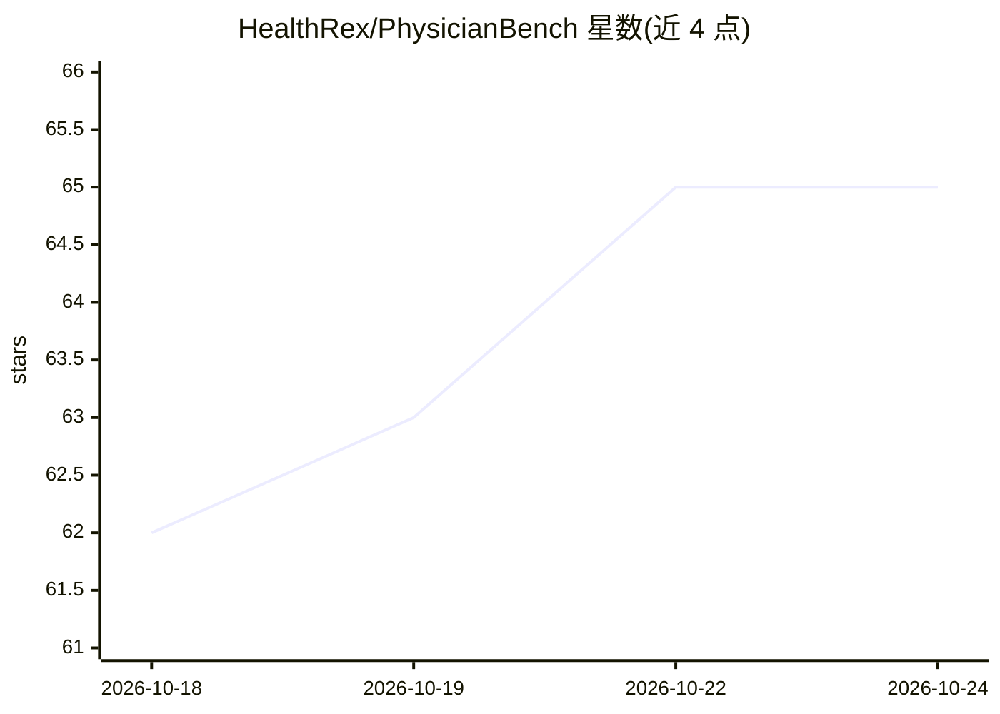

# HealthRex/PhysicianBench

⭐ 65 · Python · Apache-2.0 · 推送 2026-08-13 · [GitHub](https://github.com/HealthRex/PhysicianBench) · [官网](https://healthrex.github.io/PhysicianBench/) · 组织维护

**评测 LLM agent 在真实 EHR 环境中执行医生任务的基准与评测框架**

包含 100 个长程任务（670 个子检查点）、覆盖 21 个专科的评测基准，任务改编自真实基层与专科门诊，在预载真实患者记录、经标准 FHIR API 访问的 EHR 环境中执行。完成每个任务需跨就诊记录检索数据、对异构临床信息推理、执行临床操作并生成临床文档。提供评测 harness：每个任务自动启动独立 FHIR Docker 容器，运行 agent 后用 pytest 校验检查点，支持 OpenRouter/Anthropic/OpenAI 后端与 pass@1/pass@3 评分。面向医疗 AI 研究与评测人员。

## 筛选速览

| 维度 | 判定 | 备注 |
|---|---|---|
| AI 角色 | `ai-ecosystem` | LLM/agent 周边工具 |
| 许可风险 | `permissive` | Apache-2.0 |
| 部署形态 | `None` |  |
| 模型依赖 | locked-api |  |
| 硬件要求 | — | 无带数字的原话,不猜 |
| 安装摩擦 | `low` | 无编译、无系统依赖或容器化 |
| 成熟度 | — | 结构信号不足 |

## 能力要点

- 100 个长程任务、670 个子检查点、21 个专科，改编自真实门诊
- 在真实患者记录的 EHR/FHIR 环境中执行并校验临床操作
- 每任务自动起停 FHIR Docker 容器，pytest 校验检查点
- 支持 OpenRouter/Anthropic/OpenAI 后端，pass@1/pass@3 评分

## 适用场景

- 评测 LLM agent 在真实临床工作流中的任务完成率
- 复现论文基准结果或对新模型跑分对比
- 研究 agent 在异构临床信息上的检索与推理行为

## 场景标签

`模型评测` · 领域:评测与运维

## 证据(README 行号)

> L10: PhysicianBench is a benchmark for evaluating LLM agents on physician tasks grounded in real clinical workflows. It 
> L79: 3. Run the pytest verifier for the task's checkpoints.

## 星数曲线

2026-10-18 62 → 2026-10-24 65（+3）

---
*卡片 v1 · prompt 1.4 · 生成 2026-10-24 · 置信度 high · 依据 README sha `6ce400e35cac` · [字段定义](../../DATASET.md)*
