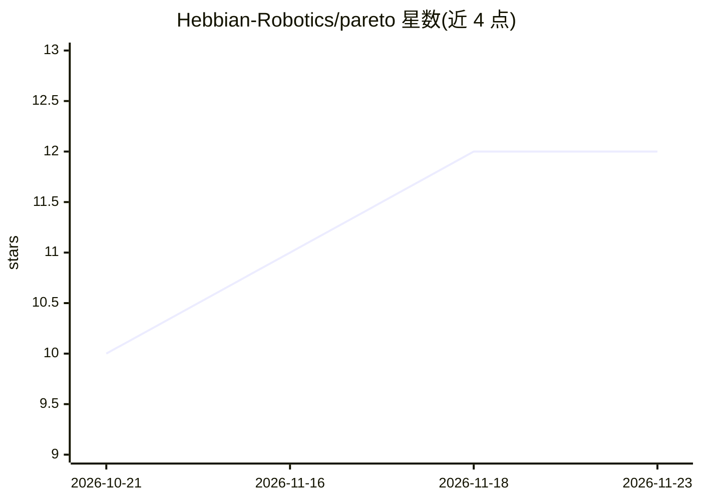

# Hebbian-Robotics/pareto

⭐ 12 · Rust · Apache-2.0 · 推送 2026-07-27 · [GitHub](https://github.com/Hebbian-Robotics/pareto) · [官网](https://pareto.hebbianrobotics.com) · 组织维护

**为机器人团队从演示数据中筛选训练样本的数据策展系统**

面向机器人模仿学习/VLA 训练的数据质量系统：上传 LeRobot 数据集后进行索引，计算视觉/轨迹/端点一致性指标，用 HDBSCAN 聚类行为，检测近似重复与异常片段，支持文本检索到帧级证据，并可导出精选子集数据集。CLI 由 Rust 编写，二进制内不含 ML 运行时，嵌入由外部 SigLIP 2 服务提供（无该服务时可用离线 mock provider）。服务器模式需要 Postgres；社区版可自托管，托管版由公司提供。

## 筛选速览

| 维度 | 判定 | 备注 |
|---|---|---|
| AI 角色 | `ai-native` | 本体是模型或模型工具 |
| 许可风险 | `permissive` | Apache-2.0 |
| 部署形态 | `self-host` | docker 或自建部署 |
| 模型依赖 | — | README 未给出锁定关系 |
| 硬件要求 | — | 无带数字的原话,不猜 |
| 安装摩擦 | `low` | 无编译、无系统依赖或容器化 |
| 成熟度 | — | 结构信号不足 |

## 能力要点

- 索引→测量→聚类→检视→选择→导出的完整数据策展流程
- 文本查询返回剧集排序与匹配帧证据（LanceDB 存储）
- 无内嵌 ML 运行时：嵌入经外部 SigLIP 2 服务，含离线 mock provider
- 可被 coding agent 通过 --json CLI 驱动进行数据集审计

## 适用场景

- 从大量演示录制中挑选进入下一轮 VLA 训练的剧集
- 检索并定位数据集中特定物体或条件出现的帧
- 对比 rollout 失败与训练数据的覆盖情况

## 场景标签

`语义搜索` `数据分析` · 领域:效率与自动化

## 证据(README 行号)

> L20: LeRobot dataset and Pareto indexes
> L153: - **No ML runtime in the binary.** Frames are embedded by an external service
> L161:  LanceDB with episode/camera/time metadata; text queries rank episodes by

## 星数曲线

2026-10-21 10 → 2026-11-23 12（+2）

---
*卡片 v1 · prompt 1.4 · 生成 2026-11-18 · 置信度 low · 依据 README sha `1bd2b6657032` · [字段定义](../../DATASET.md)*
