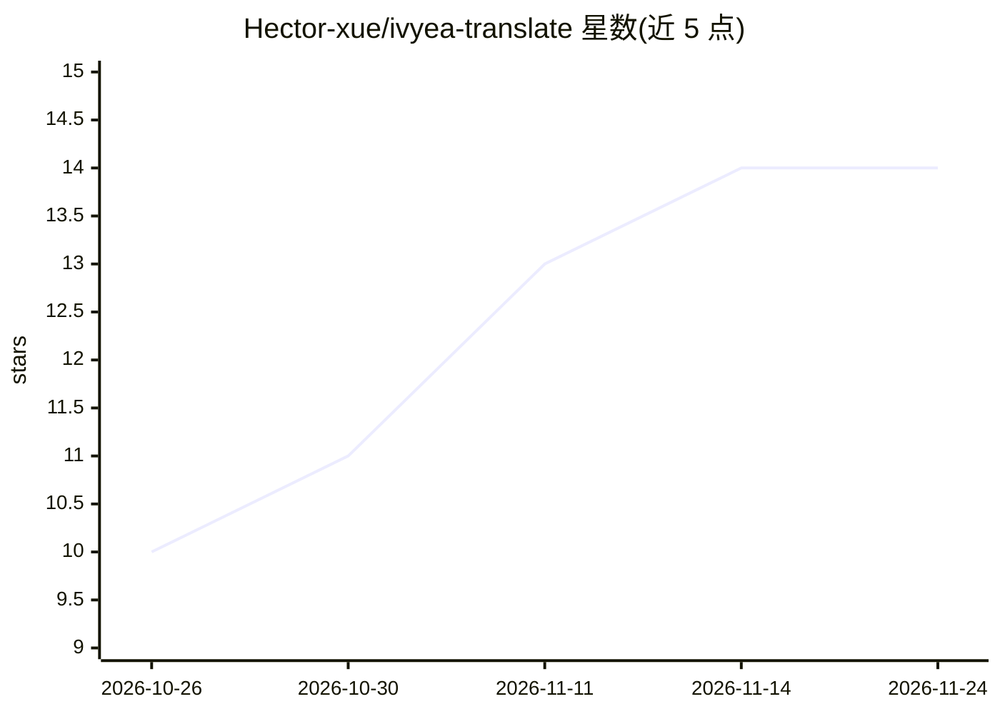

# Hector-xue/ivyea-translate

⭐ 14 · Python · MIT · 推送 2026-11-09 · [GitHub](https://github.com/Hector-xue/ivyea-translate) · [官网](https://translate.ivyea.com) · 个人维护 · 中文 README

**Windows 桌面 AI 翻译工具：划词/截图/反向写作三合一**

基于 PySide6/Qt 的桌面翻译软件，功能覆盖划词翻译（Ctrl+C+C）、截图翻译（Windows OCR 或 RapidOCR 识别后翻译，弹窗不遮原文）与反向写作（母语写邮件改写为外语并回译校对）。内置 DeepL/Google/腾讯 TranSmart/必应四端点并行对冲与自动回退的免费引擎，装完即用；可接入任意 OpenAI 兼容接口的大模型解锁风格控制与邮件改写；支持下载本地 GGUF 模型经 llama.cpp 离线运行，断网自动兜底。提供 Windows 安装版、macOS Apple Silicon Beta 与源码运行方式，带自动更新。

## 筛选速览

| 维度 | 判定 | 备注 |
|---|---|---|
| AI 角色 | `ai-native` | 本体是模型或模型工具 |
| 许可风险 | `permissive` | MIT |
| 部署形态 | `desktop` | 安装包/桌面程序 |
| 模型依赖 | local-ok | 支持本地模型 |
| 硬件要求 | — | 无带数字的原话,不猜 |
| 安装摩擦 | `low` | 无编译、无系统依赖或容器化 |
| 成熟度 | `idea` | |

## 能力要点

- 四免费端点并行对冲、自动回退，无需配置即可使用
- 截图翻译弹窗定位于框选区域外侧，不覆盖原文
- 本地离线模型：腾讯混元 1.8B GGUF + llama.cpp，支持 GPU/CPU 自适应与断点续传
- 接入任意 OpenAI 兼容接口解锁风格控制与邮件改写

## 适用场景

- 日常阅读外文网页时划词即译
- 识别截图中的外文文字并翻译且不遮挡原文
- 把中文邮件草稿改写成地道英文并回译校对
- 断网或注重隐私时用本地模型离线翻译

## 场景标签

`OCR` `AI 写作` · 领域:内容生成

## 证据(README 行号)

> L3: 桌面 AI 翻译软件（Windows 优先）：划词翻译 · 截图翻译 · 反向写作。轻量、简洁、好用。
> L101: 开箱即用：默认「自动」引擎——没配大模型就用内置免费翻译（DeepL / Google / 腾讯 TranSmart / 必应 四端点按质量排序，首选没在 0.35 秒内返回就并行补发下一个、谁先回用谁；国内网络下 TranSm

## 星数曲线

2026-10-26 10 → 2026-11-24 14（+4）

---
*卡片 v1 · prompt 1.4 · 生成 2026-11-18 · 置信度 high · 依据 README sha `410474e20e68` · [字段定义](../../DATASET.md)*
