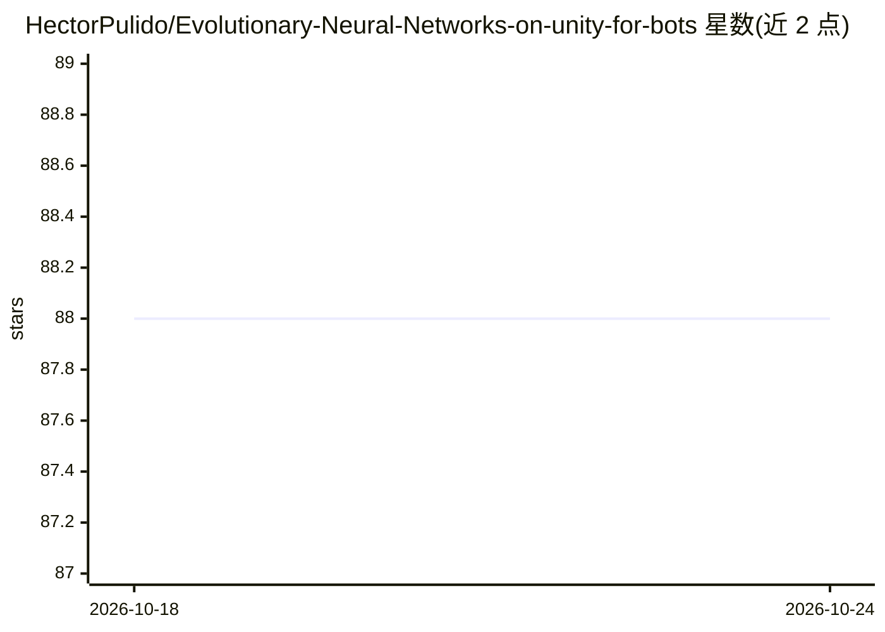

# HectorPulido/Evolutionary-Neural-Networks-on-unity-for-bots

⭐ 88 · C# · MIT · 推送 2026-07-22 · [GitHub](https://github.com/HectorPulido/Evolutionary-Neural-Networks-on-unity-for-bots) · [官网](https://www.youtube.com/watch?v=ckSKdjosxc8) · 个人维护

**Unity 资产：用遗传算法训练神经网络制作游戏 bot**

面向 Unity 2018+ 的 C# 资产：通过遗传算法（交叉与变异）训练神经网络，无需反向传播即可生成能玩游戏或与环境交互的 bot。用户继承 MendelMachine 与 BotHandler 类定义训练环境、传感器（如 raycast）与适应度函数；训练完成后可保存 .nn 文件并兼容作者的模仿学习项目。内置自动驾驶小车、Flappy Bird、恐龙克隆、Asteroids、PONG、Survival Shooter 等 6 个示例工程。作者原计划上架商店，因 Unity ML 发布而转为开源。

## 筛选速览

| 维度 | 判定 | 备注 |
|---|---|---|
| AI 角色 | `ai-native` | 本体是模型或模型工具 |
| 许可风险 | `permissive` | MIT |
| 部署形态 | `None` |  |
| 模型依赖 | — | README 未给出锁定关系 |
| 硬件要求 | — | 无带数字的原话,不猜 |
| 安装摩擦 | `medium` | 含编译或系统依赖之一 |
| 成熟度 | — | 结构信号不足 |

## 能力要点

- 遗传算法训练神经网络，不依赖反向传播
- 继承 MendelMachine/BotHandler 类自定义传感器与适应度函数
- 训练结果保存为 .nn 文件，兼容作者的模仿学习项目
- 提供自动驾驶、Flappy Bird、Asteroids、PONG 等 6 个示例

## 适用场景

- 在 Unity 游戏中训练可玩游戏的 bot 或敌人 AI
- 不写反向传播的情况下学习神经网络训练
- 教学演示遗传算法与神经网络的结合

## 场景标签

 · 领域:游戏开发/AI

## 证据(README 行号)

> L3: This is a simple asset that train a neural networks using genetic algorithm in unity to make a bot that can play a g
> L35: Open it on unity 2018 or greater (sorry about that >-< ), is also recomended to set the scripting runtime version i

## 星数曲线

2026-10-18 88 → 2026-10-24 88（+0）

---
*卡片 v1 · prompt 1.4 · 生成 2026-10-23 · 置信度 high · 依据 README sha `6fb44a3217c5` · [字段定义](../../DATASET.md)*
