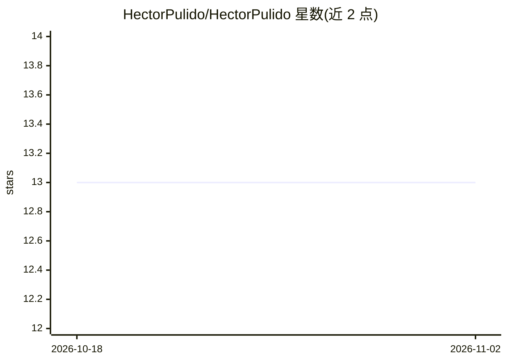

# HectorPulido/HectorPulido

⭐ 13 · Python · MIT · 推送 2026-11-01 · [GitHub](https://github.com/HectorPulido/HectorPulido) · [官网](https://www.youtube.com/@Hector.Pulido) · 个人维护

**个人 GitHub 主页 README（自动生成），展示开发者技能与项目**

Hector Pulido 的 GitHub 个人主页配置仓库，README 由生成器自动生成，内容包括自我介绍（数据科学家与独立游戏开发者）、技术栈清单（Python/Flask/Django、PyTorch、Rust 与 WASM、Unity3D、Arduino 等）、所属独立游戏开发小组 Pequesoft 的介绍、项目与视频栏目以及社交媒体链接。README 本身不提供安装或运行方式，页脚注明其为自动生成并可查看生成方式。

## 筛选速览

| 维度 | 判定 | 备注 |
|---|---|---|
| AI 角色 | `ai-knowledge` | 知识聚合/清单类 |
| 许可风险 | `permissive` | MIT |
| 部署形态 | `None` |  |
| 模型依赖 | — | README 未给出锁定关系 |
| 硬件要求 | — | 无带数字的原话,不猜 |
| 安装摩擦 | `low` | 无编译、无系统依赖或容器化 |
| 成熟度 | — | 结构信号不足 |

## 能力要点

- 自动生成的个人主页 README
- 列出数学、Python、PyTorch、Rust/WASM、Unity3D 等技术栈
- 介绍独立游戏开发小组 Pequesoft

## 适用场景

- 了解 Hector Pulido 的技术背景与联系方式
- 查看其所属游戏开发小组 Pequesoft 的信息

## 场景标签

 · 领域:个人主页/开发者展示

## 证据(README 行号)

> L1: # Hello, Hector Pulido is Here! 👋
> L48:  * This is an autogenerated readme click here to see how was done

## 星数曲线

2026-10-18 13 → 2026-11-02 13（+0）

---
*卡片 v1 · prompt 1.4 · 生成 2026-10-31 · 置信度 low · 依据 README sha `b6f2557f5230` · [字段定义](../../DATASET.md)*
