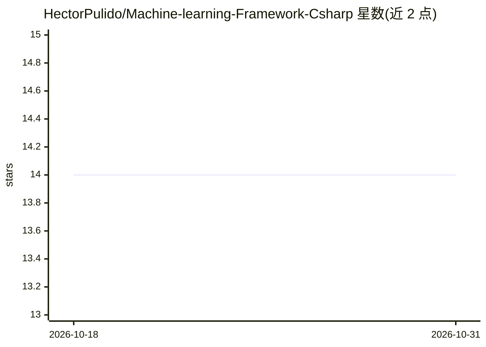

# HectorPulido/Machine-learning-Framework-Csharp

⭐ 14 · C# · MIT · 推送 2026-07-22 · [GitHub](https://github.com/HectorPulido/Machine-learning-Framework-Csharp) · 个人维护

**C# 极简类 PyTorch 自动微分框架，零依赖可入 Unity**

TAS（Training Autograd System）是用 C# 编写的类 PyTorch 机器学习框架，基于同仓库的 SimpleLinearAlgebra 零依赖矩阵库构建。提供动态计算图、自动微分（张量级 Backward）、Linear/Sigmoid/ReLu 层、Sequential 封装、MSE 损失与 SGD 优化器；附 XOR、正弦回归、手推梯度验证等示例及三个纯矩阵实现的从零神经网络。全部目标 netstandard2.0，可在 .NET、.NET Framework、Mono 与 Unity 中运行，甚至可直接复制源码进 Assets 目录。当前张量仅支持 2 维，TODO 中列出真张量与性能改进。

## 筛选速览

| 维度 | 判定 | 备注 |
|---|---|---|
| AI 角色 | `ai-ecosystem` | LLM/agent 周边工具 |
| 许可风险 | `permissive` | MIT |
| 部署形态 | `None` |  |
| 模型依赖 | — | README 未给出锁定关系 |
| 硬件要求 | — | 无带数字的原话,不猜 |
| 安装摩擦 | `medium` | 含编译或系统依赖之一 |
| 成熟度 | — | 结构信号不足 |

## 能力要点

- 动态计算图 + 自动微分（Add/MatMul/Transpose/Sum 等算子）
- SimpleLinearAlgebra 零外部依赖，netstandard2.0，兼容 Unity
- 含从零实现的感知机（单层/多层）与卷积网络示例
- xUnit 测试套件与 CI

## 适用场景

- 在 C#/Unity 项目中从零学习神经网络与自动微分原理
- 作为教学/实验用的轻量训练框架
- 在无外部依赖约束的 .NET 环境中跑小型稠密网络

## 场景标签

`模型训练` · 领域:训练与推理

## 证据(README 行号)

> L3: **TAS (Training Autograd System)** is a minimalist pytorch-like machine learning framework made with C#, built on to
> L17: |`src/DLFramework`|The TAS framework: tensors, autograd operations, layers, losses and optimizers|

## 星数曲线

2026-10-18 14 → 2026-10-31 14（+0）

---
*卡片 v1 · prompt 1.4 · 生成 2026-10-31 · 置信度 high · 依据 README sha `4de9bc8431a6` · [字段定义](../../DATASET.md)*
