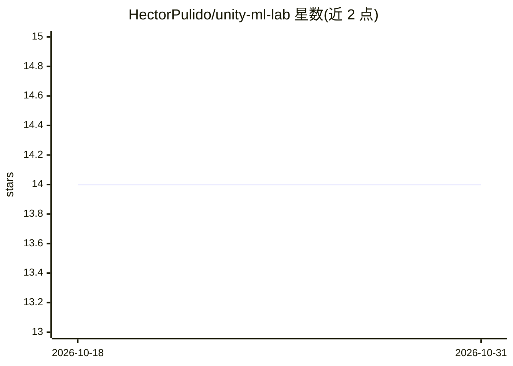

# HectorPulido/unity-ml-lab

⭐ 14 · C# · MIT · 推送 2026-07-22 · [GitHub](https://github.com/HectorPulido/unity-ml-lab) · [官网](https://youtu.be/nwqnGh2FiUo) · 个人维护

**Unity 机器学习实验集合：模仿学习、遗传算法、强化学习与 LLM 绑定**

将多个独立仓库合并而成的 Unity + AI 实验集，每个文件夹为自带 README 的独立项目：录制游戏状态与玩家动作后训练神经网络做模仿学习；三个遗传算法示例（函数最小化、旅行商问题等）；Pong 上的策略梯度（神经网络与 softmax 两种方式）；基于自研 TAS/DLF autograd 框架在 Unity 中做强化学习；以及通过 Python websockets 连接 Llama 2 的 client/server 绑定。另列出保持独立的相关仓库。面向 Unity 游戏开发者与机器学习实验者。

## 筛选速览

| 维度 | 判定 | 备注 |
|---|---|---|
| AI 角色 | `ai-native` | 本体是模型或模型工具 |
| 许可风险 | `permissive` | MIT |
| 部署形态 | `None` |  |
| 模型依赖 | — | README 未给出锁定关系 |
| 硬件要求 | — | 无带数字的原话,不猜 |
| 安装摩擦 | `low` | 无编译、无系统依赖或容器化 |
| 成熟度 | — | 结构信号不足 |

## 能力要点

- 模仿学习：录制游戏状态与玩家动作训练神经网络
- 三个遗传算法示例（函数最小化、旅行商等）
- 基于自研 TAS/DLF autograd 框架的 Unity 强化学习
- Llama 2 的 Python websockets client/server 绑定

## 适用场景

- 在 Unity 游戏中训练模仿玩家行为的神经网络
- 用策略梯度或遗传算法做游戏 AI 实验
- 让 Unity 游戏通过 websockets 调用 Llama 2

## 场景标签

`强化学习` · 领域:训练与推理

## 证据(README 行号)

> L13: ||**imitation-learning**|Record the game state and the player's actions, then train a neural network to imitate the
> L16: ||**dlf-reinforcement-learning**|Reinforcement learning in Unity using DLF/TAS, the from-scratch autograd framework

## 星数曲线

2026-10-18 14 → 2026-10-31 14（+0）

---
*卡片 v1 · prompt 1.4 · 生成 2026-10-31 · 置信度 high · 依据 README sha `0f66b9f57f47` · [字段定义](../../DATASET.md)*
