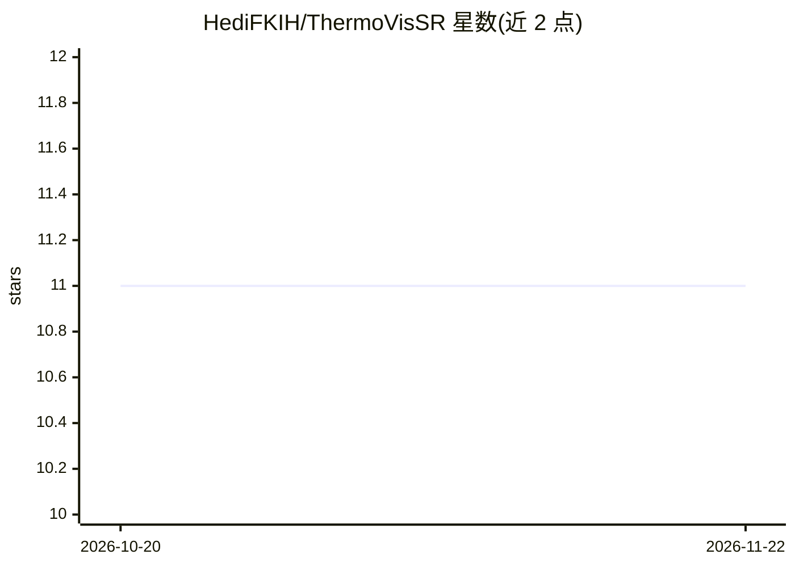

# HediFKIH/ThermoVisSR

⭐ 11 · Python · CC0-1.0 · 推送 2025-12-03 · [GitHub](https://github.com/HediFKIH/ThermoVisSR) · [官网](https://hedifkih.github.io/ThermoVisSR/) · 组织维护

**面向科研者的可见光/热红外无人机图像双流超分辨率模型**

论文「Multi-scale transformer network for super-resolution of visible and thermal air images」的官方 PyTorch 实现。模型对小型/微型无人机的可见光与热红外图像做 4×/8× 超分辨率：双流分别处理 RGB 与 IR，高/低频分离处理，多尺度纹理 transformer 做参考图对应匹配，融合骨干保留颜色与形态。训练脚本 train.sh、评估脚本 eval.sh 给出 PSNR/SSIM/MS-SSIM/VIF 指标。配套数据集含 736 对训练、146 对测试图像，仅限学术用途、需邮件申请。许可为 CC BY-NC-ND 4.0。

## 筛选速览

| 维度 | 判定 | 备注 |
|---|---|---|
| AI 角色 | `ai-native` | 本体是模型或模型工具 |
| 许可风险 | `viral` | CC0-1.0 |
| 部署形态 | `None` |  |
| 模型依赖 | — | README 未给出锁定关系 |
| 硬件要求 | — | 无带数字的原话,不猜 |
| 安装摩擦 | `medium` | 含编译或系统依赖之一 |
| 成熟度 | — | 结构信号不足 |

## 能力要点

- 可见光与热红外双流处理加多尺度纹理 transformer 的超分辨率网络
- 提供 4× 与 8× 放大倍率及 PSNR/SSIM/MS-SSIM/VIF 评估
- 发布小型/微型无人机可见光-热红外配准数据集（882 对图像，学术用途需申请）
- 给出训练时长与显存参考（Tesla T4 约 15 小时 16GB，A100 约 8 小时 40GB）

## 适用场景

- 对无人机航拍图像做 4×/8× 超分辨率重建
- 低光条件下增强热红外监控图像细节
- 为无人机检测识别研究准备高分辨率训练数据

## 场景标签

`科研工具` `图像视频处理` · 领域:学习与行业

## 证据(README 行号)

> L17: **ThermoVisSR** is a state-of-the-art multi-scale texture transformer designed for The super-resolution of both **v
> L145: sh train.sh
> L160: sh eval.sh

## 星数曲线

2026-10-20 11 → 2026-11-22 11（+0）

---
*卡片 v1 · prompt 1.4 · 生成 2026-11-19 · 置信度 high · 依据 README sha `04f8ae85642c` · [字段定义](../../DATASET.md)*
