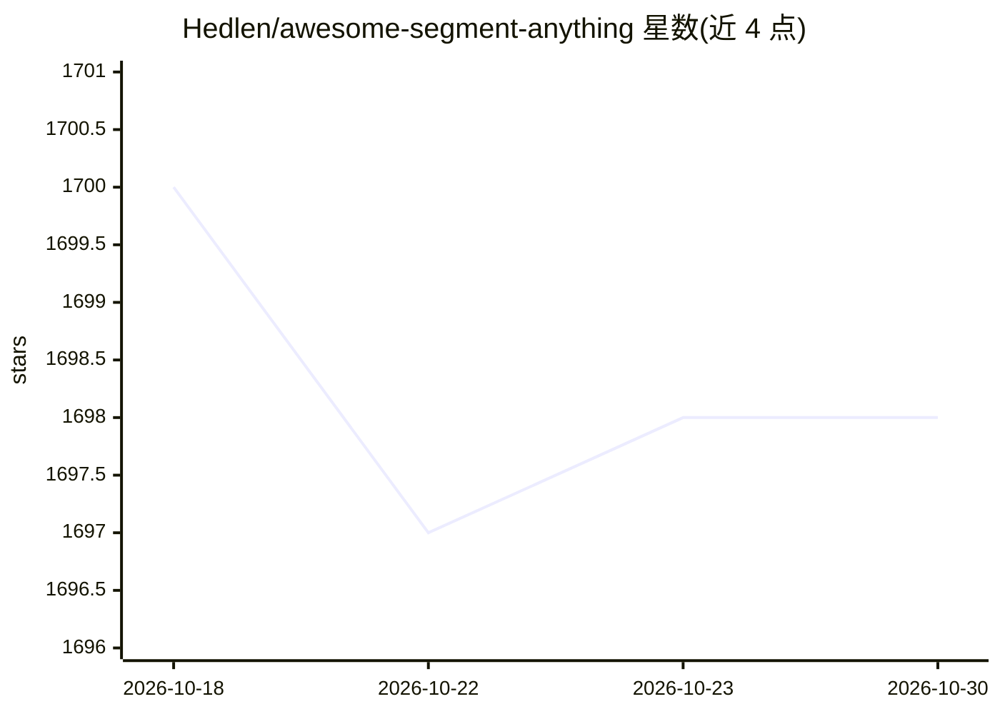

# Hedlen/awesome-segment-anything

⭐ 1,698 · MIT · 推送 2026-04-26 · [GitHub](https://github.com/Hedlen/awesome-segment-anything) · 个人维护

**追踪 Segment Anything 相关论文与项目的策展清单**

面向计算机视觉研究者的 SAM 生态跟踪仓库：以表格形式收录 SAM 系列基础模型（SAM/SAM 2/SAM 3）及衍生论文与项目，按分析与扩展、医学图像分割、生物图像、图像修复、伪装目标检测、视频帧插值、抠图、机器人、3D 等主题分类，每条含论文页、项目页、代码库与机构信息，并有 News 部分记录新增条目。仓库本身不含代码，仅做链接汇总，持续更新至 2026 年。

## 筛选速览

| 维度 | 判定 | 备注 |
|---|---|---|
| AI 角色 | `ai-knowledge` | 知识聚合/清单类 |
| 许可风险 | `permissive` | MIT |
| 部署形态 | `None` |  |
| 模型依赖 | — | README 未给出锁定关系 |
| 硬件要求 | — | 无带数字的原话,不猜 |
| 安装摩擦 | `low` | 无编译、无系统依赖或容器化 |
| 成熟度 | — | 结构信号不足 |

## 能力要点

- 按 10 余个主题分类组织 SAM 衍生研究条目
- 每条含论文/项目/代码/机构链接的表格结构
- 追踪 SAM 至 SAM 2/SAM 3 的版本演进（News 部分）

## 适用场景

- 查找 SAM 在医学影像、3D、抠图等方向的衍生工作
- 跟踪 Segment Anything 系列模型的演进
- 按主题浏览可复现的 SAM 相关开源项目

## 场景标签

`精选清单` · 领域:学习与行业

## 证据(README 行号)

> L4: Segment Anything has led to a new breakthrough in the field of Computer Vision (CV), and this repository will contin
> L23: ## Papers/Projects

## 星数曲线

2026-10-18 1,700 → 2026-10-30 1,698（-2）

---
*卡片 v1 · prompt 1.4 · 生成 2026-10-21 · 置信度 high · 依据 README sha `7f1b63da175b` · [字段定义](../../DATASET.md)*
