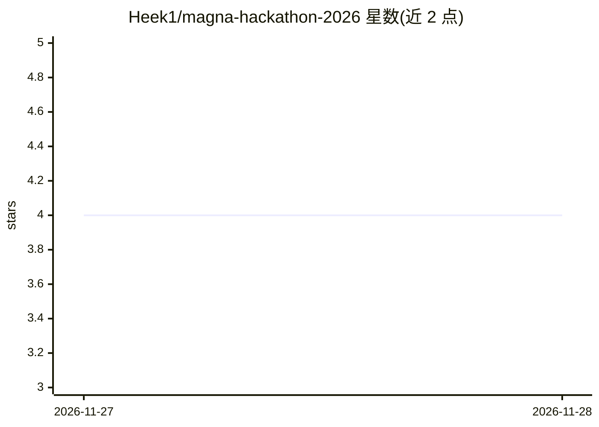

# Heek1/magna-hackathon-2026

⭐ 4 · Python · 推送 2026-11-11 · [GitHub](https://github.com/Heek1/magna-hackathon-2026) · [官网](https://oee-engine.onrender.com/) · 组织维护

**面向电驱产线的手机端 OEE 损失发现与预测应用**

Magna Hackathon 2026 产出的手机优先应用，读取一份产线数据工作簿并由模拟器回放：检测引擎找出重复发生的停机、速度损失与废品模式，预测下一次停机时间与预期损失，计算修复后的 OEE 增益并关联责任人与对策步骤。内置基于 Gemini API 的问答助手，仅基于产线数据回答问题，模型不可用时回退到引擎答案。后端 FastAPI+SQLite，前端 React PWA，提供 Docker 一容器部署、本地脚本与开发模式。

## 筛选速览

| 维度 | 判定 | 备注 |
|---|---|---|
| AI 角色 | `ai-enhanced` | 去掉 AI 部分产品仍成立 |
| 许可风险 | `none` | — |
| 部署形态 | `self-host` | docker 或自建部署 |
| 模型依赖 | — | README 未给出锁定关系 |
| 硬件要求 | — | 无带数字的原话,不猜 |
| 安装摩擦 | `low` | 无编译、无系统依赖或容器化 |
| 成熟度 | — | 结构信号不足 |

## 能力要点

- 按工作日×小时模式预测下一次停机并倒计时提示
- Gemini 问答仅基于产线数据，支持英/斯洛伐克/乌克兰语
- What-if 计算修复后的 OEE 前后对比与产量增益
- PWA 可安装，含角色筛选与桌面/投影布局

## 适用场景

- 产线班组长按角色查看当日待修复的首要停机
- 提前获知下一次预计停机并指派修复任务
- 用问答助手追问 OEE 波动的成因

## 场景标签

`数据分析` `聊天机器人` · 领域:效率与自动化

## 证据(README 行号)

> L14: fix, and answers "why?" with an AI assistant that only uses the line data.
> L64:                                 ├ AI assistant (Gemini) ──┤  answers from the line data only

## 星数曲线

2026-11-27 4 → 2026-11-28 4（+0）

---
*卡片 v1 · prompt 1.4 · 生成 2026-11-27 · 置信度 mid · 依据 README sha `131798807829` · [字段定义](../../DATASET.md)*
