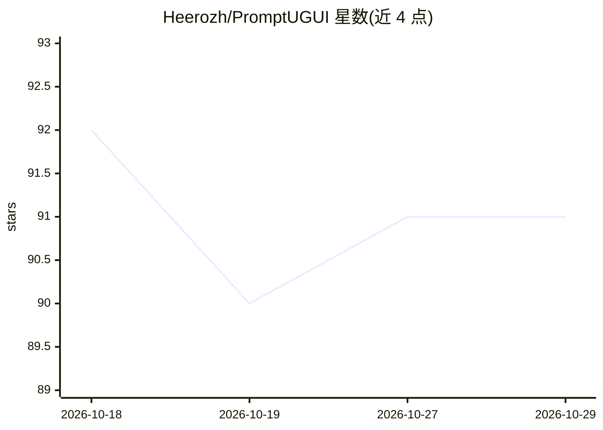

# Heerozh/PromptUGUI

⭐ 91 · C# · Apache-2.0 · 推送 2026-10-22 · [GitHub](https://github.com/Heerozh/PromptUGUI) · 个人维护 · 中文 README

**面向 Code Agent 的 Unity uGUI 框架：用文本描述直接生成界面**

一个面向 Code Agent / LLM 的 Unity UI 框架，支持 Unity 2022.3+ / Unity 6+。核心机制：提供极简 XML 描述语言 .ui.xml 与像素图风格 Sprite 描述语言 .pxl，由运行时解析器转译为 uGUI 层级与 Sprite 图像，目标是免去人工切图流程；无需生图模型即可由 Agent 从文字描述绘制 UI 素材。附带热重载、响应式布局、手柄导航、自动 i18n（调用 OpenAI 兼容模型翻译）、Addressables 热更、Router 深链等。通过 UPM git URL 或 Claude Code 提示词安装，手动安装需 DotNet SDK 10、NuGetForUnity、R3、LitMotion 等前置依赖。

## 筛选速览

| 维度 | 判定 | 备注 |
|---|---|---|
| AI 角色 | `ai-ecosystem` | LLM/agent 周边工具 |
| 许可风险 | `permissive` | Apache-2.0 |
| 部署形态 | `None` |  |
| 模型依赖 | — | README 未给出锁定关系 |
| 硬件要求 | — | 无带数字的原话,不猜 |
| 安装摩擦 | `medium` | 含编译或系统依赖之一 |
| 成熟度 | — | 结构信号不足 |

## 能力要点

- .ui.xml / .pxl 文本描述语言由运行时解析为 uGUI 层级 + Sprite 图像
- 无需生图模型，Code Agent 可从文字描述直接产出 UI 素材并调整风格
- 自动 i18n：提取文本发送至 OpenAI 兼容模型翻译，支持人工注释回传上下文
- 附带面向 Claude Code / Codex 等 Agent Skills 规范的技能文件

## 适用场景

- 让 Code Agent 按 Figma 或截图直接生成 Unity 界面，跳过切图流程
- 通过热重载与 UI Preview 快速迭代 UI 布局
- 为游戏做多语言界面并按语言按需下载资源

## 场景标签

 · 领域:游戏开发/UI 框架

## 证据(README 行号)

> L5: A UI Framework friendly to Code Agents, aiming to bypassing manual asset slicing by generate final visual results di
> L7: It provides an extremely concise UI description language `.ui.xml` & `.pxl` , and a runtime parser that translates i
> L26:  - No image-generation model required — a Code Agent can draw UI art and adjust its style straight from text descri

## 星数曲线

2026-10-18 92 → 2026-10-29 91（-1）

---
*卡片 v1 · prompt 1.4 · 生成 2026-10-23 · 置信度 high · 依据 README sha `526910afb48d` · [字段定义](../../DATASET.md)*
