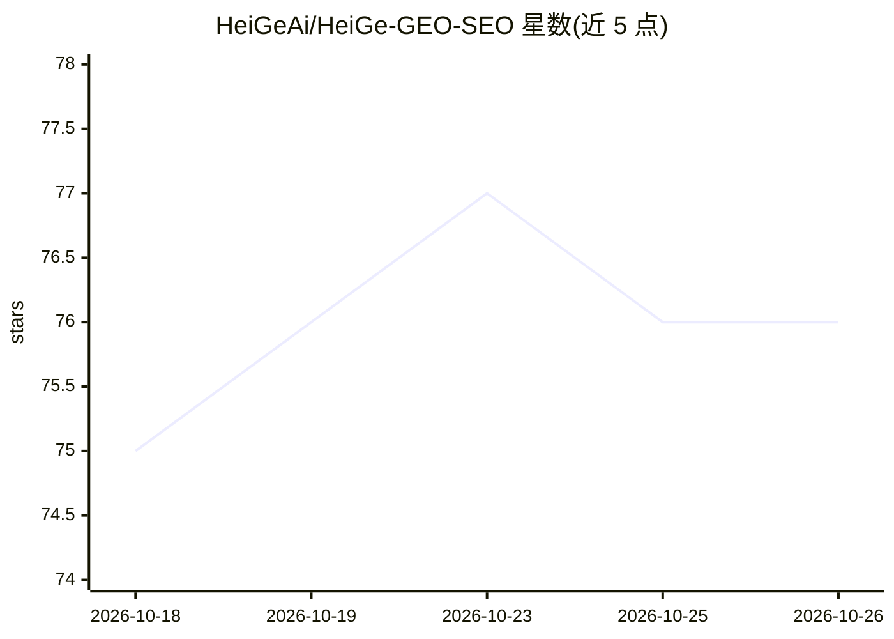

# HeiGeAi/HeiGe-GEO-SEO

⭐ 76 · Python · MIT · 推送 2026-10-15 · [GitHub](https://github.com/HeiGeAi/HeiGe-GEO-SEO) · 个人维护 · 中文 README

**中国市场优先的 GEO+SEO 内容优化工具包：让内容被 AI 引用**

零依赖 Python CLI 工具包加知识库，用于生成式引擎优化（GEO）与 SEO：对网页打 6 维 22 项可被引用度分、诊断未被引用根因、生成改写指令包/robots/llms.txt/JSON-LD、做信源策略规划、声量份额（SOV）度量与平台发布推荐（基于新榜数据），覆盖豆包/千问/DeepSeek/文心等国内引擎与 11 个海外引擎。方法论来自 GEO（KDD 2024）与 AutoGEO（ICLR 2026）论文。另可通过 build.py 转译为 Claude Code/Codex/OpenClaw/Hermes 的 agent 技能包。评分确定性、离线运行、不调用 LLM。

## 筛选速览

| 维度 | 判定 | 备注 |
|---|---|---|
| AI 角色 | `ai-knowledge` | 知识聚合/清单类 |
| 许可风险 | `permissive` | MIT |
| 部署形态 | `None` |  |
| 模型依赖 | — | README 未给出锁定关系 |
| 硬件要求 | — | 无带数字的原话,不猜 |
| 安装摩擦 | `low` | 无编译、无系统依赖或容器化 |
| 成熟度 | — | 结构信号不足 |

## 能力要点

- 6 维 22 项可被引用度评分卡与 7 根因诊断，确定性可进 CI
- 改写指令编译器：LLM 无关，按目标引擎分叉输出改写指令包
- 国内 4+ 海外 11 引擎的平台发布推荐与 SOV/错误信息度量
- canonical 单源转译为 Claude Code/Codex/OpenClaw/Hermes 技能包

## 适用场景

- 优化落地页/公众号文章以提高被豆包、ChatGPT 等 AI 引用的概率
- 诊断内容为何没被 AI 引用并按 ROI 排序行动
- 规划该在哪些平台发布内容以喂给目标 AI 引擎
- 作为 Claude Code 等 agent 的技能安装使用

## 场景标签

`AI 写作` · 领域:内容生成

## 证据(README 行号)

> L10: > 中国市场优先的 GEO(生成式引擎优化)+ SEO 内容优化系统。让你的内容和网页被豆包、通义千问、DeepSeek、文心、腾讯元宝、ChatGPT、Perplexity、Claude、Gemini 抓取并引用。
> L20: HeiGe-GEO-SEO 把三层缝成一个原创工具:

## 星数曲线

2026-10-18 75 → 2026-10-26 76（+1）

---
*卡片 v1 · prompt 1.4 · 生成 2026-10-24 · 置信度 high · 依据 README sha `13b45af3c871` · [字段定义](../../DATASET.md)*
