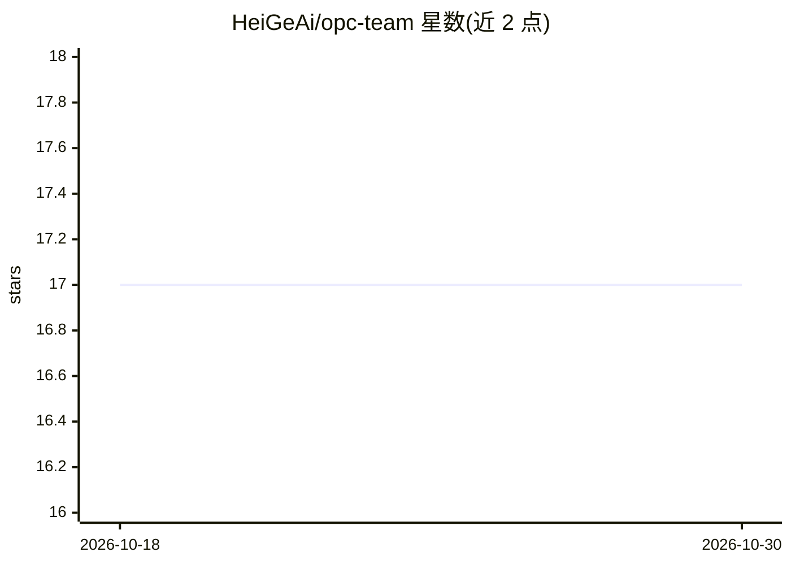

# HeiGeAi/opc-team

⭐ 17 · Python · MIT · 推送 2026-09-23 · [GitHub](https://github.com/HeiGeAi/opc-team) · 个人维护 · 中文 README

**跨平台 Agent 协作运维框架：状态机、决策履历、风险评分与三级记忆**

面向在 Claude Code、OpenClaw、Cursor、Windsurf 或通用 CLI/API 工作流中运行 Agent 的用户，OPC Team 提供一套 Python CLI 工具集，把 Agent 执行过程工程化：任务状态机、决策履历（记录选项/假设/回填）、概率×影响的风险量化评分、L0/L1/L2 三级记忆同步，以及 21 角色默认目录与 daily/important/full 三档弹性编组（3/9/21 角色）。支持 SQLite/文件存储、模型路由与本地看板。安装通过 install.sh 或 pip install -e .。限制：Deal Guard 规则库为硬编码中文信号词，非英文/谐音变体会漏检。

## 筛选速览

| 维度 | 判定 | 备注 |
|---|---|---|
| AI 角色 | `ai-ecosystem` | LLM/agent 周边工具 |
| 许可风险 | `permissive` | MIT |
| 部署形态 | `library` | 以包/库形式分发 |
| 模型依赖 | — | README 未给出锁定关系 |
| 硬件要求 | — | 无带数字的原话,不猜 |
| 安装摩擦 | `low` | 无编译、无系统依赖或容器化 |
| 成熟度 | — | 结构信号不足 |

## 能力要点

- 任务状态机 + 决策履历 + 风险评分 + 三级记忆的可审计 CLI 工具集
- 21 角色默认目录，daily/important/full 三档弹性编组（3/9/21）
- 一份角色目录可导出为 Claude Code/OpenClaw/Cursor/Windsurf/API 集成文件
- 主从 Agent 编排、独立模型路由与本地可视化看板

## 适用场景

- 给 Claude Code/Cursor 等 Agent 加上可回放、可审计的执行约束
- 把任务决策、风险和跨任务经验沉淀为结构化记录
- 按任务强度自动伸缩 Agent 协作规模

## 场景标签

`Agent 框架` `多智能体` `Agent 记忆` · 领域:Agent 开发

## 证据(README 行号)

> L15: **OPC Team** 是一个跨平台的 Agent 协作框架，目标不是再造一个角色扮演 prompt，而是给 AI 执行过程加上明确的工程化约束：任务状态机、决策履历、风险量化、三级记忆，以及一组可审计的 CLI 工具。它适合跑
> L21: - **不是纯 Prompt 模板**：核心能力是 `tools/*.py` 里的状态机、决策、风险、记忆和配置系统，不只是“设定一个 COO 角色”。
> L134: - **Claude Code / OpenClaw / Cursor / Windsurf**：安装后直接下达自然语言指令，让 Agent 按 `SKILL.md` 调用 CLI。

## 星数曲线

2026-10-18 17 → 2026-10-30 17（+0）

---
*卡片 v1 · prompt 1.4 · 生成 2026-10-30 · 置信度 high · 依据 README sha `3fa3832bc6ed` · [字段定义](../../DATASET.md)*
