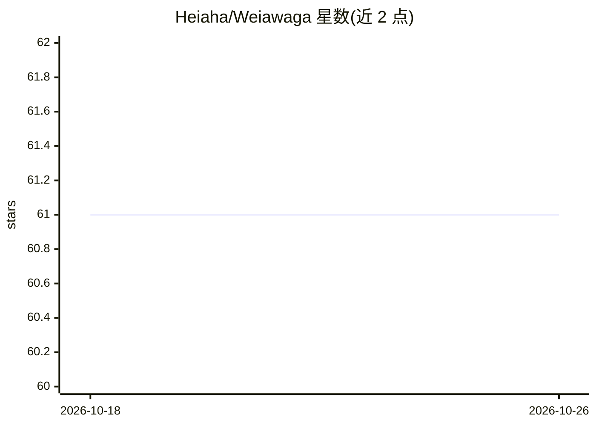

# Heiaha/Weiawaga

⭐ 61 · Rust · GPL-3.0 · 推送 2026-10-13 · [GitHub](https://github.com/Heiaha/Weiawaga) · 个人维护

**Rust 编写的 UCI 国际象棋引擎（NNUE 评估 + alpha-beta 搜索）**

自包含的 UCI 协议国际象棋引擎：位棋盘与 fancy magic 走法生成，主体搜索采用主变化 alpha-beta 框架，含迭代加深、期望窗口、无锁置换表与 Lazy SMP 并行。评估部分为自研 NNUE 神经网络，使用 SIMD 推理，权重在编译期嵌入二进制。供 UCI 兼容界面（cutechess、Arena、Banksia、En Croissant 等）调用，支持 Hash、Threads、MultiPV、Ponder 等 UCI 选项。构建需 stable Rust 1.97+，通过 cargo build --release 编译。

## 筛选速览

| 维度 | 判定 | 备注 |
|---|---|---|
| AI 角色 | `ai-native` | 本体是模型或模型工具 |
| 许可风险 | `viral` | GPL-3.0 |
| 部署形态 | `None` |  |
| 模型依赖 | — | README 未给出锁定关系 |
| 硬件要求 | — | 无带数字的原话,不猜 |
| 安装摩擦 | `medium` | 含编译或系统依赖之一 |
| 成熟度 | — | 结构信号不足 |

## 能力要点

- NNUE 评估网络（SIMD 推理，权重编译期嵌入）
- 主变化 alpha-beta 搜索 + 迭代加深/期望窗口/Lazy SMP
- 位棋盘与 fancy magic 走法生成
- 标准 UCI 协议，兼容 cutechess/Arena/Banksia 等界面

## 适用场景

- 接入 UCI 图形界面进行对局或分析
- 在 cutechess 等工具中做引擎对弈测试
- 研究现代国际象棋引擎的搜索与 NNUE 实现

## 场景标签

 · 领域:游戏AI/棋类引擎

## 证据(README 行号)

> L13: efficiently updatable neural network (NNUE) with SIMD inference, trained with
> L10: with a principal variation alpha-beta framework. It includes iterative deepening,

## 星数曲线

2026-10-18 61 → 2026-10-26 61（+0）

---
*卡片 v1 · prompt 1.4 · 生成 2026-10-24 · 置信度 high · 依据 README sha `e130b39bd0c6` · [字段定义](../../DATASET.md)*
