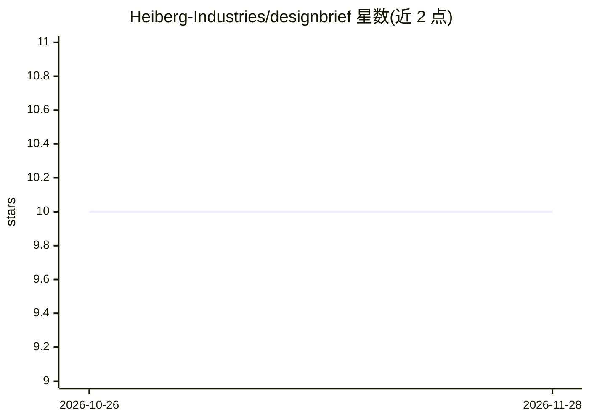

# Heiberg-Industries/designbrief

⭐ 10 · JavaScript · MIT · 推送 2026-02-20 · [GitHub](https://github.com/Heiberg-Industries/designbrief) · [官网](https://tools.heiberg.co/designbrief) · 组织维护

**给 AI 编码助手提供 UI 设计方向的风格守则文件库**

包含 21 个 markdown 风格文件，每个定义一种视觉方向的设计守则：字体、配色、间距、组件行为、暗色模式、响应式、无障碍等，形式为约束规则而非具体模板。通过 npx 安装器自动检测并复制技能文件，支持 Claude Code、Cursor、Windsurf、GitHub Copilot、OpenAI Codex，也提供 skills.sh、skild.sh 安装途径和手动复制方案；遵循 Agent Skills 开放标准，激活后按用户请求确定风格、加载对应文件并应用守则。MIT 许可。

## 筛选速览

| 维度 | 判定 | 备注 |
|---|---|---|
| AI 角色 | `ai-knowledge` | 知识聚合/清单类 |
| 许可风险 | `permissive` | MIT |
| 部署形态 | `library` | 以包/库形式分发 |
| 模型依赖 | — | README 未给出锁定关系 |
| 硬件要求 | — | 无带数字的原话,不猜 |
| 安装摩擦 | `low` | 无编译、无系统依赖或容器化 |
| 成熟度 | — | 结构信号不足 |

## 能力要点

- 21 个风格守则文件，覆盖 Typography、配色、间距、无障碍等维度
- npx 安装器自动检测工具并放置技能文件
- 遵循 Agent Skills 开放标准
- 支持手动粘贴任意 LLM 上下文使用

## 适用场景

- 让 Claude Code 按 Glassmorphism 风格生成 SaaS 落地页
- 为 fintech 仪表盘选择合适的设计方向
- 把风格文件粘贴进任意 LLM 对话约束 UI 输出

## 场景标签

`提示工程` · 领域:Agent 开发

## 证据(README 行号)

> L3: **Design direction for AI-generated UI.** 21 style guardrail files that give LLMs the context to build tasteful, con
> L9: Each style is a markdown file defining the **design DNA** of a visual direction — typography, color theory, spacing 
> L120: designbrief follows the Agent Skills open standard. When activated, the skill:

## 星数曲线

2026-10-26 10 → 2026-11-28 10（+0）

---
*卡片 v1 · prompt 1.4 · 生成 2026-11-20 · 置信度 high · 依据 README sha `0f0e877349d5` · [字段定义](../../DATASET.md)*
