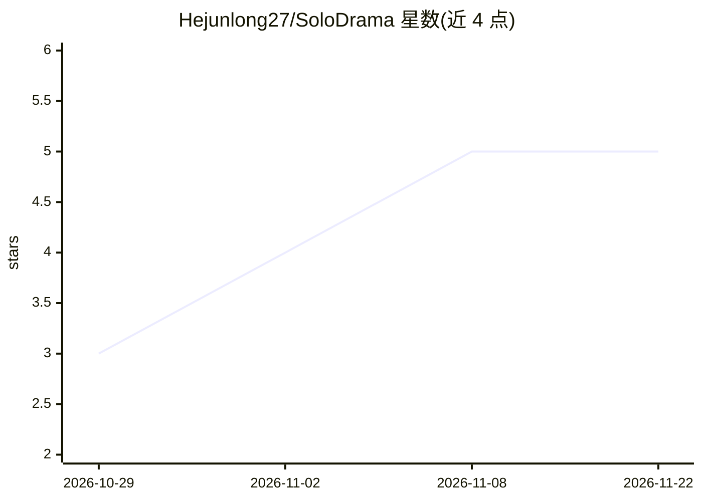

# Hejunlong27/SoloDrama

⭐ 5 · Python · Apache-2.0 · 推送 2026-11-13 · [GitHub](https://github.com/Hejunlong27/SoloDrama) · 个人维护 · 中文 README

**给个人创作者的短剧批量生产流水线工具**

本地运行的短剧生产工具集，覆盖从一句话点子到成片与成本台账的链路：创作层用可插拔的 markdown 题材模板生成剧本/分镜/提示词，执行层调用本机或云端 ComfyUI 出图出片，层间以文件为契约传递。提供 FastAPI 图形工作台（默认 127.0.0.1:8788）与命令行两种入口，含只读演示模式、模型确认单门禁与预检机制。Windows+N 卡可全链路本机运行，无独显时出图出片走云端或平台通道，macOS/Linux 仅控制台与命令行且引擎侧未做端到端验证。

## 筛选速览

| 维度 | 判定 | 备注 |
|---|---|---|
| AI 角色 | `ai-native` | 本体是模型或模型工具 |
| 许可风险 | `permissive` | Apache-2.0 |
| 部署形态 | `desktop` | 安装包/桌面程序 |
| 模型依赖 | — | README 未给出锁定关系 |
| 硬件要求 | `gpu-8g` | |
| 安装摩擦 | `low` | 无编译、无系统依赖或容器化 |
| 成熟度 | — | 结构信号不足 |

## 能力要点

- 创作模板可插拔：只写 markdown，引擎只读 JSON，层间传文件
- 模型确认单（model-plan.json）门禁：无 choice 即拒绝执行，通道只读一次
- 三种安装路径：Windows 一键 start.cmd、git clone 手动装、整段提示词交给 AI 助手
- 支持只读演示模式与端口自动递增、--host/--no-browser 等服务器部署参数

## 适用场景

- 把一个点子批量做成竖屏短剧
- 无独显机器上做创作/审片/导出，出片走云端通道
- 给同网段同事开放只读工作台演示

## 场景标签

`图像生成` `视频生成` · 领域:内容生成

## 证据(README 行号)

> L3: **把一句话点子做成可发布竖屏短剧的流水线。**
> L146:     subgraph L1["① 创作层 · 人 × LLM"]
> L171: 三条路，同一个执行器、同一套预检。通道只从「模型确认单」读一次，界面与命令行不会各有各的答案。

## 星数曲线

2026-10-29 3 → 2026-11-22 5（+2）

---
*卡片 v1 · prompt 1.4 · 生成 2026-11-21 · 置信度 high · 依据 README sha `3c7078718284` · [字段定义](../../DATASET.md)*
