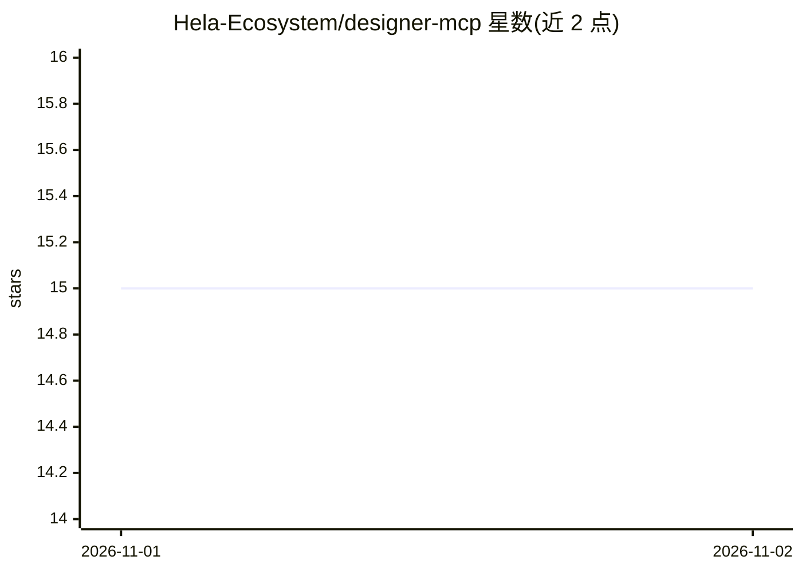

# Hela-Ecosystem/designer-mcp

⭐ 15 · HTML · MIT · 推送 2026-10-31 · [GitHub](https://github.com/Hela-Ecosystem/designer-mcp) · [官网](http://demo-designer.glassgallery.my.id/) · 组织维护

**面向生产级 UI/品牌设计的 MCP server：46 个设计工具与质量门**

TypeScript 实现的 Model Context Protocol（MCP）服务器，属于 HeLa MCP Ecosystem 的设计组件（hela-phenotype）。提供 46 个工具：35 项反粗糙质量门与 6 轴自评、OKLCH token 系统（19 套主题、自动深色模式派生）、18 种设计系统的规则生成、WCAG 2.1 静态无障碍审计（25 项检查、0-100 评分）、React/Vue/HTML 组件输出、CSS/SCSS 多格式生成、motion.dev 与 anime.js 动效片段，以及含 1,432 个商标参考库的 logo 设计工具（8 个 logo_* 工具）。另有 9 个 Stitch Canvas 工具用于设计工作流集成。给使用 MCP 客户端的开发者的设计工具服务。

## 筛选速览

| 维度 | 判定 | 备注 |
|---|---|---|
| AI 角色 | `ai-ecosystem` | LLM/agent 周边工具 |
| 许可风险 | `permissive` | MIT |
| 部署形态 | `library` | 以包/库形式分发 |
| 模型依赖 | — | README 未给出锁定关系 |
| 硬件要求 | — | 无带数字的原话,不猜 |
| 安装摩擦 | `low` | 无编译、无系统依赖或容器化 |
| 成熟度 | — | 结构信号不足 |

## 能力要点

- 35 项反粗糙质量门 + 6 轴（P-H-E-S-R-V）自评，低于 3 分触发修订
- OKLCH token 生成，19 套主题，自动派生深色模式 CSS
- WCAG 2.1 静态审计：25 项检查、0-100 评分、A-F 等级与修复建议
- logo 工具集含 1,432 个真实商标 SVG 参考库与多格式交付变体

## 适用场景

- 在 AI 客户端中生成符合设计系统规范的组件与 token
- 对现有页面做 WCAG 2.1 无障碍审计与反粗糙检查
- 设计 logo 并生成 mono/方形/favicon 等交付变体
- 导出框架无关的 CSS/SCSS 与 Tailwind 配置

## 场景标签

`代码生成` · 领域:编码与开发

## 证据(README 行号)

> L8: A **Design-Theory-as-a-Service** Model Context Protocol (MCP) server for production-grade UI design. Unlike standard
> L10: 46 tools across 18 design systems (including Awwwards SOTA / Avant-Garde): **anti-slop quality gates**, **motion.de

## 星数曲线

2026-11-01 15 → 2026-11-02 15（+0）

---
*卡片 v1 · prompt 1.4 · 生成 2026-10-31 · 置信度 high · 依据 README sha `0c2766a29983` · [字段定义](../../DATASET.md)*
