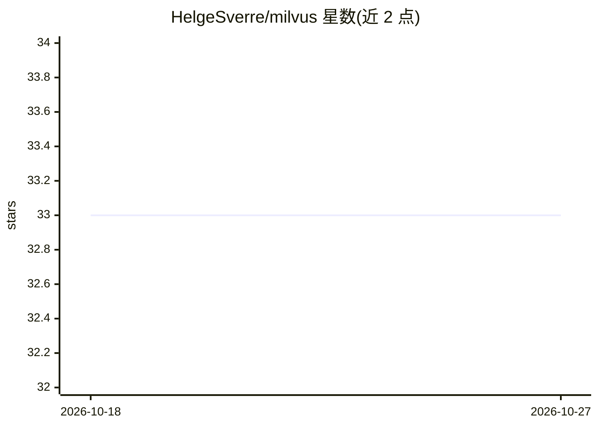

# HelgeSverre/milvus

⭐ — · [GitHub]() · 个人维护

**PHP/Laravel 的 Milvus 向量数据库 REST API 客户端**

基于 Saloon 构建的 PHP 客户端，封装 Milvus REST v2 稳定端点，支持 Milvus 2.5 至 3.0（测试覆盖 2.5.21/2.6.21/3.0.0）。提供数据库、集合、向量增删改查、过滤检索、自定义 schema、AutoID、Milvus 3 的按 ID 检索与部分 upsert 等操作，返回 Saloon 响应与校验过的 DTO。可作为 Laravel 门面使用（配置文件发布、服务提供者），也可独立作为 Saloon 连接器运行，支持 Zilliz Cloud 云端接入。运行时要求 PHP 8.3–8.5，Laravel 可选。通过 Composer 安装。

## 筛选速览

| 维度 | 判定 | 备注 |
|---|---|---|
| AI 角色 | `ai-ecosystem` | LLM/agent 周边工具 |
| 许可风险 | `permissive` | — |
| 部署形态 | `self-host` | docker 或自建部署 |
| 模型依赖 | — | README 未给出锁定关系 |
| 硬件要求 | — | 无带数字的原话,不猜 |
| 安装摩擦 | `low` | 无编译、无系统依赖或容器化 |
| 成熟度 | — | 结构信号不足 |

## 能力要点

- 封装 Milvus REST v2 端点，测试覆盖 Milvus 2.5.21/2.6.21/3.0.0
- 支持 Laravel 门面与独立 Saloon 连接器两种使用方式
- 返回校验 DTO，throwIfFailed 抛出 MilvusApiException 与 InvalidResponseException
- 支持 Zilliz Cloud 云端集群接入

## 适用场景

- 在 Laravel/PHP 应用中接入 Milvus 向量数据库
- 构建基于 OpenAI Embeddings 的语义搜索
- 管理 Milvus 数据库、集合与向量的增删改查

## 场景标签

`向量数据库` · 领域:知识与检索

## 证据(README 行号)

> L12: This package is a PHP client for the stable Milvus REST v2 endpoints shared by Milvus 2.5 through 3.0. It is tested
> L46: PHP 8.3–8.5 is supported. Laravel is optional; the client can also be used as a standalone Saloon connector.

## 星数曲线

2026-10-18 33 → 2026-10-27 33（+0）

---
*卡片 v1 · prompt 1.4 · 生成 2026-10-25 · 置信度 mid · 依据 README sha `b928a20a4efc` · [字段定义](../../DATASET.md)*
