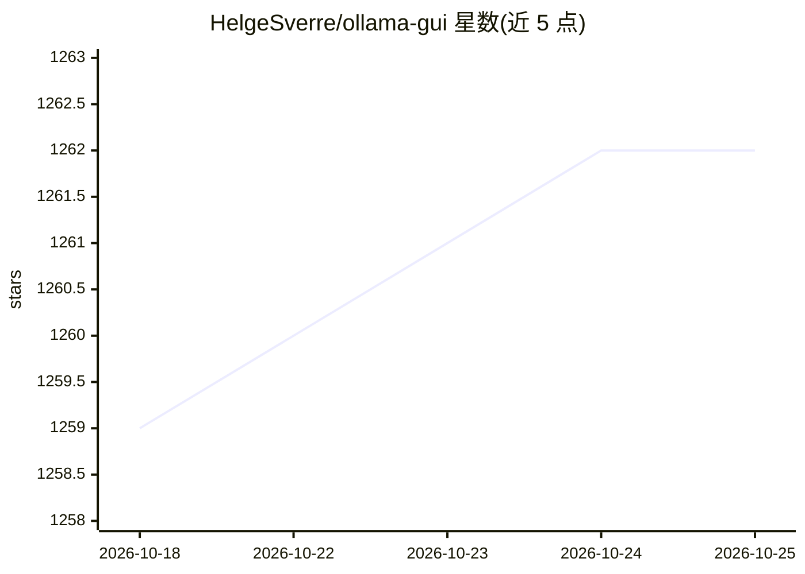

# HelgeSverre/ollama-gui

⭐ 1,262 · TypeScript · MIT · 推送 2026-10-23 · [GitHub](https://github.com/HelgeSverre/ollama-gui) · [官网](https://ollama-gui.vercel.app/) · 个人维护

**浏览器直连 Ollama 的本地 LLM 聊天 Web 界面**

基于 Vue 的单页应用，从浏览器直接调用 Ollama API 与本地模型对话，自身无后端：聊天记录存在浏览器 IndexedDB，除访问所配置的 Ollama 服务器外不离开本机。支持流式回复与版本分支、thinking 模型（qwen3/deepseek-r1/gpt-oss）、图像与文件附件、模型库搜索与拉取、系统提示词与生成参数设置。提供 Docker 镜像、托管版与静态部署方式；开发需 Bun 与 Node.js 20+，运行需已有 Ollama。

## 筛选速览

| 维度 | 判定 | 备注 |
|---|---|---|
| AI 角色 | `ai-ecosystem` | LLM/agent 周边工具 |
| 许可风险 | `permissive` | MIT |
| 部署形态 | `self-host` | docker 或自建部署 |
| 模型依赖 | local-ok | 支持本地模型 |
| 硬件要求 | — | 无带数字的原话,不猜 |
| 安装摩擦 | `low` | 无编译、无系统依赖或容器化 |
| 成熟度 | — | 结构信号不足 |

## 能力要点

- 无自建后端，聊天数据存于浏览器 IndexedDB
- 支持 thinking 模型的推理过程折叠展示与开关
- 模型库搜索、按尺寸拉取、删除与卸载
- 聊天全量 JSON 导入导出、全文搜索（⌘K）

## 适用场景

- 给本机 Ollama 配一个自托管的聊天界面
- 在局域网内多设备访问同一 Ollama 服务
- 对比和管理多个本地模型与生成参数

## 场景标签

`聊天机器人` · 领域:对话与助手

## 证据(README 行号)

> L4:  A web interface for chatting with local models through Ollama.
> L12: Ollama GUI is a single-page app that talks directly to the Ollama API from your browser. There is no backend of its

## 星数曲线

2026-10-18 1,259 → 2026-10-25 1,262（+3）

---
*卡片 v1 · prompt 1.4 · 生成 2026-10-21 · 置信度 high · 依据 README sha `209097993882` · [字段定义](../../DATASET.md)*
