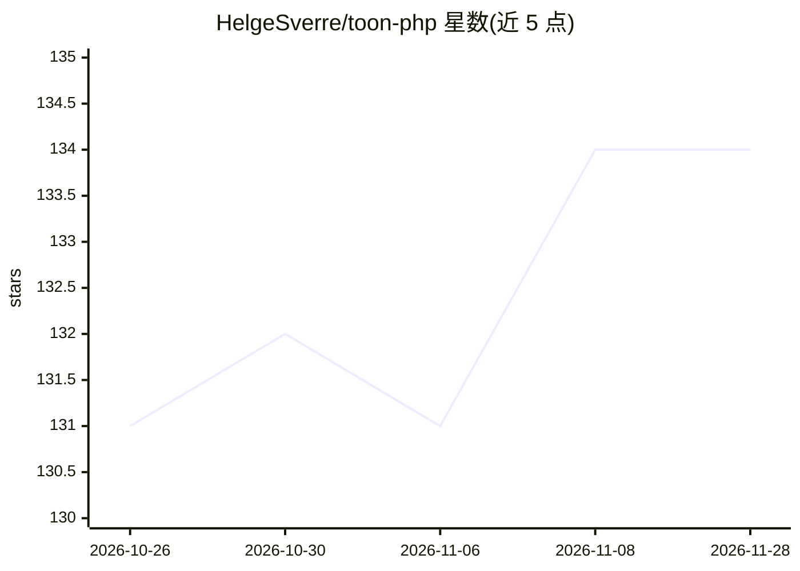

# HelgeSverre/toon-php

⭐ 134 · PHP · MIT · 推送 2026-11-06 · [GitHub](https://github.com/HelgeSverre/toon-php) · [官网](https://github.com/HelgeSverre/toon-php) · 个人维护

**PHP 开发者的 TOON 格式库：压缩发往 LLM 的结构化数据**

toon-format/toon 的 PHP 移植实现，提供 TOON（Token-Oriented Object Notation）格式的双向编码与解码：将 PHP 数组/对象序列化为对 LLM 上下文更省 token 的紧凑文本，也可将 TOON 字符串解码回关联数组并支持不解码的校验。核心机制包括统一对象数组的表头/行式表格格式、可配置缩进、字符串按需加引号、DateTime 与 PHP enum 的自动归一化，并可通过 EncodeOptions/DecodeOptions 显式选择 3.3/4.1/4.4 三个规范版本。通过 Composer 安装，要求 PHP 8.1+；README 注明不适用于替代 JSON 做通用 API 或数据存储。

## 筛选速览

| 维度 | 判定 | 备注 |
|---|---|---|
| AI 角色 | `ai-ecosystem` | LLM/agent 周边工具 |
| 许可风险 | `permissive` | MIT |
| 部署形态 | `None` |  |
| 模型依赖 | — | README 未给出锁定关系 |
| 硬件要求 | — | 无带数字的原话,不猜 |
| 安装摩擦 | `low` | 无编译、无系统依赖或容器化 |
| 成熟度 | — | 结构信号不足 |

## 能力要点

- 双向转换：编码为 TOON 与解码回 PHP 关联数组，另有不解码的输入校验 API
- 表头声明字段、行式数据的表格格式，对统一对象数组实现 token 节省
- 通过 EncodeOptions/DecodeOptions 显式切换 3.3/4.1/4.4 三个规范版本
- 自动处理字符串引号、DateTime ISO 8601、PHP enum 与非有限数值

## 适用场景

- 在 LLM 提示词中发送结构化数据并减少 token 消耗
- 降低调用语言模型 API 时的 token 成本
- 提高上下文窗口中的数据利用率
- 配合 Ollama/OpenAI 客户端构建 RAG 管线时压缩输入数据

## 场景标签

 · 领域:LLM 基础设施/数据格式

## 证据(README 行号)

> L8: A PHP port of toon-format/toon - a compact data format designed to reduce token
> L9: consumption when sending structured data to Large Language Models.
> L269: - Sending structured data in LLM prompts
> L274: **Note**: TOON is optimized for LLM contexts and is not intended as a replacement for JSON in APIs or data storage

## 星数曲线

2026-10-26 131 → 2026-11-28 134（+3）

---
*卡片 v1 · prompt 1.4 · 生成 2026-11-28 · 置信度 high · 依据 README sha `382194992f97` · [字段定义](../../DATASET.md)*
