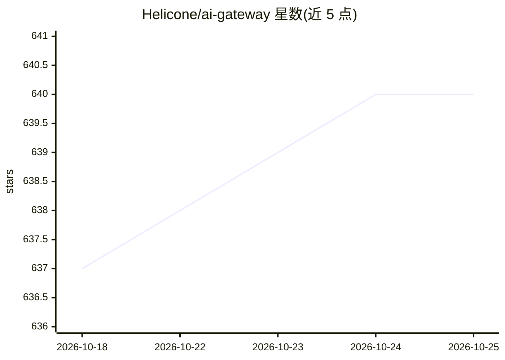

# Helicone/ai-gateway

⭐ 640 · Rust · GPL-3.0 · 推送 2025-11-21 · [GitHub](https://github.com/Helicone/ai-gateway) · [官网](https://docs.helicone.ai/ai-gateway) · 组织维护

**开源 LLM 网关：统一 API 接入 100+ 模型并路由**

由 Helicone 团队开源、用 Rust 编写的 LLM API 网关：以 OpenAI 语法统一请求 OpenAI、Anthropic、Google、AWS Bedrock 等 20+ 提供商；提供智能路由（延迟/成本/权重策略）、按用户/团队/全局的速率限制与花费控制、响应缓存（Redis/S3 后端）、OpenTelemetry 可观测。支持云托管与自托管（npx 本地运行、config.yaml 自定义、Docker/Kubernetes 部署指南）。面向需要统一接入与治理 LLM 请求的开发者与企业，Apache 2.0 许可，处于 Public Beta。

## 筛选速览

| 维度 | 判定 | 备注 |
|---|---|---|
| AI 角色 | `ai-ecosystem` | LLM/agent 周边工具 |
| 许可风险 | `viral` | GPL-3.0 |
| 部署形态 | `self-host` | docker 或自建部署 |
| 模型依赖 | locked-api |  |
| 硬件要求 | — | 无带数字的原话,不猜 |
| 安装摩擦 | `low` | 无编译、无系统依赖或容器化 |
| 成熟度 | `idea` | |

## 能力要点

- 以 OpenAI 语法统一请求 20+ LLM 提供商
- 智能路由：模型延迟、P2C+PeakEWMA、权重分布、成本优化策略
- 按用户/团队/全局的速率限制，支持请求数/token/金额
- 响应缓存（Redis/S3）与 OpenTelemetry 日志/指标/追踪

## 适用场景

- 用一套 OpenAI 兼容 API 接入多家 LLM 提供商
- 按延迟或成本自动选择提供商用
- 对团队或用户的 LLM 用量设置花费与速率限制
- 自托管网关并按 config.yaml 自定义路由策略

## 场景标签

`模型网关` · 领域:Agent 开发

## 证据(README 行号)

> L42: Request **any LLM provider** using familiar OpenAI syntax. Stop rewriting integrations—use one API for OpenAI, Anth
> L86: │   Your App      │───▶│ Helicone AI     │───▶│  LLM Providers  │

## 星数曲线

2026-10-18 637 → 2026-10-25 640（+3）

---
*卡片 v1 · prompt 1.4 · 生成 2026-10-21 · 置信度 mid · 依据 README sha `653edd50c345` · [字段定义](../../DATASET.md)*
