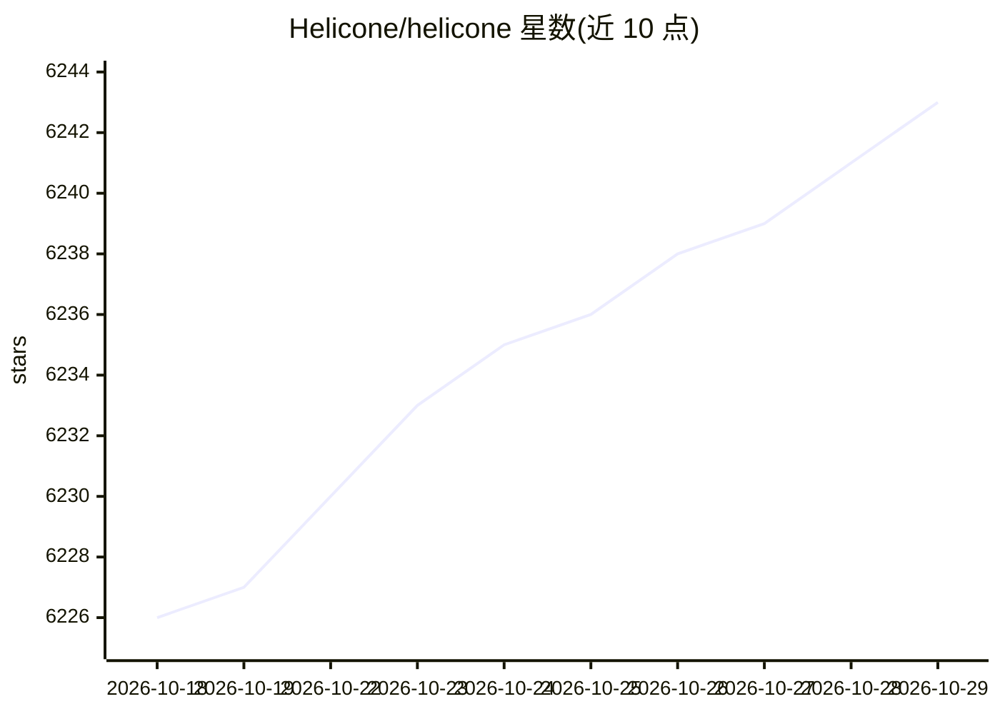

# Helicone/helicone

⭐ 6,243 · TypeScript · Apache-2.0 · 推送 2026-10-28 · [GitHub](https://github.com/Helicone/helicone) · [官网](https://www.helicone.ai) · 组织维护

**开源 LLM 可观测性与 AI 网关平台，一行代码接入**

面向 AI 工程师的开源 LLM 可观测平台：通过替换 baseURL 一行接入 OpenAI、Anthropic、LangChain 等请求日志，提供 trace/session 检查、成本与延迟指标、Prompt 版本管理、Playground 与微调合作通道；AI Gateway 以单一 API key 经 OpenAI 兼容接口访问 100+ 模型并支持智能路由与自动回退。云端提供每月 1 万次请求的免费层；可经 Docker Compose 或 Helm 自托管，架构含 Web、Worker、Jawn、Supabase、ClickHouse、Minio 六个组件。Apache v2.0 许可。

## 筛选速览

| 维度 | 判定 | 备注 |
|---|---|---|
| AI 角色 | `ai-ecosystem` | LLM/agent 周边工具 |
| 许可风险 | `permissive` | Apache-2.0 |
| 部署形态 | `library` | 以包/库形式分发 |
| 模型依赖 | local-ok | 支持本地模型 |
| 硬件要求 | — | 无带数字的原话,不猜 |
| 安装摩擦 | `low` | 无编译、无系统依赖或容器化 |
| 成熟度 | — | 结构信号不足 |

## 能力要点

- 一行代码（改 baseURL）接入请求日志记录
- AI Gateway 以单一 API key 经 OpenAI 兼容 API 访问 100+ 模型
- trace/session 检查与成本、延迟等指标分析，可一行导出 PostHog
- 提供 Docker Compose 自托管与企业级 Helm chart

## 适用场景

- 为调用多家 LLM 的应用统一记录与分析成本、延迟、质量指标
- 调试 agent 与聊天机器人的调用链 trace
- 通过单一网关管理多模型路由与自动回退

## 场景标签

`模型网关` `LLM 可观测性` · 领域:Agent 开发

## 证据(README 行号)

> L15: ## Helicone is an AI Gateway & LLM Observability Platform for AI Engineers
> L18: - 🔌 **Quick integration**: One-line of code to log all your requests from OpenAI, Anthropic, LangChain, Gemini, Ver
> L20: - 📈 **Analyze**: Track metrics like cost, latency, quality, and more. Export to PostHog in one-line for custom dash

## 星数曲线

2026-10-18 6,226 → 2026-10-29 6,243（+17）

---
*卡片 v1 · prompt 1.4 · 生成 2026-10-20 · 置信度 high · 依据 README sha `c9e2db280668` · [字段定义](../../DATASET.md)*
