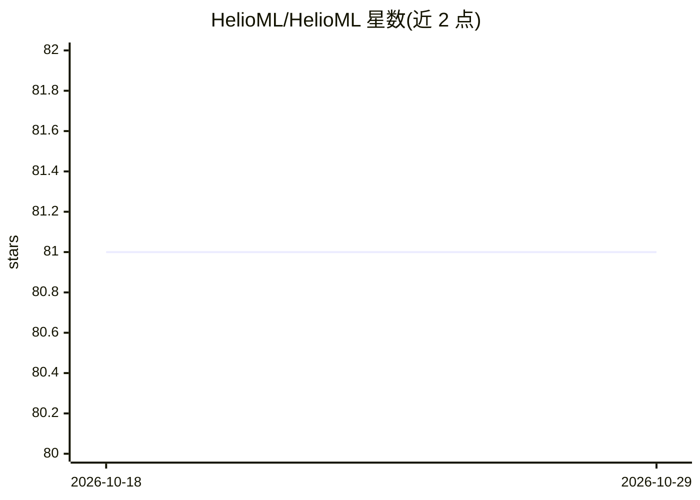

# HelioML/HelioML

⭐ 81 · Jupyter Notebook · BSD-3-Clause · 推送 2026-03-26 · [GitHub](https://github.com/HelioML/HelioML) · [官网](http://helioml.org) · 个人维护

**日球物理领域的机器学习与数据挖掘教程书（Jupyter 笔记本）**

HelioML 是一本关于机器学习、统计学与数据挖掘在日球物理学中应用的开源书籍，以一组 Python 编写的交互式 Jupyter 笔记本为主体，展示如何对多种日球物理数据集应用相关技术并复现已发表论文的结果。内容由 Monica Bobra 与 James P. Mason 编写，各版本通过 Zenodo 发布并提供 DOI 引用，正文采用 CC BY-NC-ND 4.0 许可供免费阅读。

## 筛选速览

| 维度 | 判定 | 备注 |
|---|---|---|
| AI 角色 | `ai-knowledge` | 知识聚合/清单类 |
| 许可风险 | `permissive` | BSD-3-Clause |
| 部署形态 | `None` |  |
| 模型依赖 | — | README 未给出锁定关系 |
| 硬件要求 | — | 无带数字的原话,不猜 |
| 安装摩擦 | `low` | 无编译、无系统依赖或容器化 |
| 成熟度 | — | 结构信号不足 |

## 能力要点

- 交互式 Jupyter 笔记本（Python）展示机器学习技术在日球物理数据上的应用
- 复现已发表研究结果
- 各版本通过 Zenodo 发布并附 DOI

## 适用场景

- 日球物理研究者学习如何对领域数据集应用机器学习方法
- 复现领域内已发表的机器学习分析结果
- 引用本书作为教学或科研参考

## 场景标签

`教程课程` `科研工具` · 领域:学习与行业

## 证据(README 行号)

> L3: This is the source code for a book about machine learning, statistics, and data mining for heliophysics.
> L5: This book includes a collection of interactive Jupyter notebooks, written in Python, that explicitly shows the reade

## 星数曲线

2026-10-18 81 → 2026-10-29 81（+0）

---
*卡片 v1 · prompt 1.4 · 生成 2026-10-24 · 置信度 high · 依据 README sha `d9f7421aab39` · [字段定义](../../DATASET.md)*
