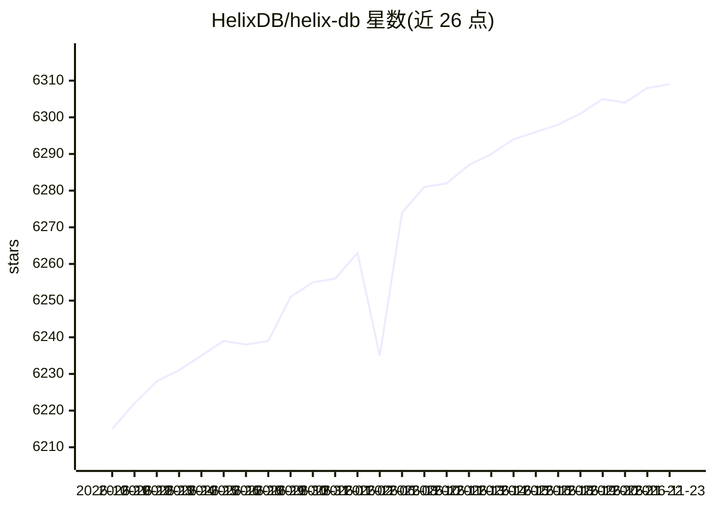

# HelixDB/helix-db

⭐ 6,309 · Rust · Apache-2.0 · 推送 2026-11-22 · [GitHub](https://github.com/HelixDB/helix-db) · [官网](https://helix-db.com) · 组织维护

**面向 AI 应用的内置向量与全文检索的 Rust 图数据库**

HelixDB 是一个开源（Apache 2.0）的 OLTP 图数据库，用 Rust 编写、基于对象存储，原生集成向量近似最近邻搜索与 BM25 全文检索，可在同一事务引擎中存储实体、关系、嵌入与文本。README 给出的用途是 AI 应用的记忆与检索：长期 agent 记忆、GraphRAG/混合 RAG 和内部知识图谱；向量搜索可被图遍历预过滤。通过 CLI 安装，本地实例依赖 Docker 或 Podman，也支持嵌入式运行与 Helix Cloud 托管部署，提供 Rust/TypeScript/Python/Go 四种 SDK。

## 筛选速览

| 维度 | 判定 | 备注 |
|---|---|---|
| AI 角色 | `ai-ecosystem` | LLM/agent 周边工具 |
| 许可风险 | `permissive` | Apache-2.0 |
| 部署形态 | `library` | 以包/库形式分发 |
| 模型依赖 | — | README 未给出锁定关系 |
| 硬件要求 | — | 无带数字的原话,不猜 |
| 安装摩擦 | `low` | 无编译、无系统依赖或容器化 |
| 成熟度 | — | 结构信号不足 |

## 能力要点

- 同一事务引擎内组合图遍历、向量相似度与 BM25 关键词搜索
- 向量作为节点/边属性原生索引，支持图遍历预过滤
- 提供 helix chef：安装查询技能与 docs MCP 并交由编码 agent 脚手架构建
- 支持嵌入式、本地/自托管服务器与 Helix Cloud 三种运行方式，共享同一套 SDK

## 适用场景

- 为 agent 构建长期记忆与知识图谱存储
- 搭建 GraphRAG 或混合 RAG 检索后端
- 把文档、人员、工具与决策关联成内部知识图谱

## 场景标签

`向量数据库` `知识图谱` · 领域:知识与检索

## 证据(README 行号)

> L17: HelixDB is an open-source (Apache 2.0) graph database with native vector search and BM25
> L170: Memory and retrieval for AI applications: long-term agent memory, GraphRAG and hybrid RAG, and
> L78: Write queries with an SDK and send them to a running instance through `POST /v2/query`. There is

## 星数曲线

2026-10-21 6,215 → 2026-11-23 6,309（+94）

---
*卡片 v1 · prompt 1.4 · 生成 2026-11-22 · 置信度 high · 依据 README sha `26fc4a369fea` · [字段定义](../../DATASET.md)*
