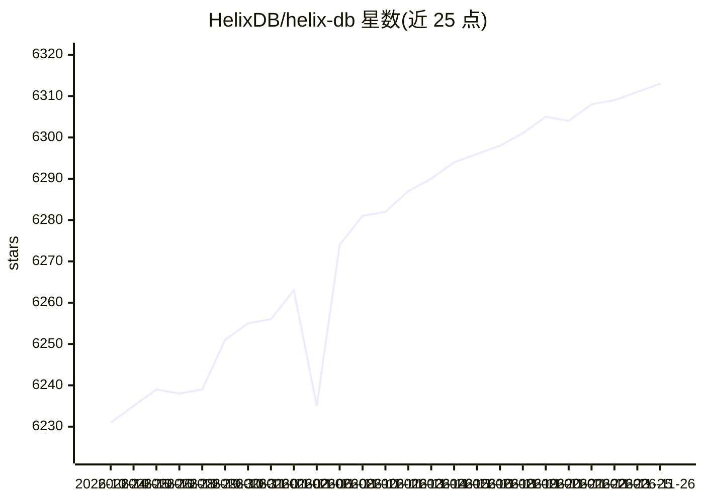

# HelixDB/helix-db

⭐ 6,313 · Rust · Apache-2.0 · 推送 2026-11-25 · [GitHub](https://github.com/HelixDB/helix-db) · [官网](https://helix-db.com) · 组织维护

**为 AI 应用提供图+向量+全文检索的 Rust 图数据库**

用 Rust 编写的开源 OLTP 图数据库（Apache 2.0），在对象存储之上原生集成向量近似最近邻搜索与 BM25 全文检索，单引擎事务化存储实体、关系、嵌入与文本，一条查询可同时组合图遍历、向量相似与关键词搜索。面向 AI 应用的记忆与检索场景：agent 长期记忆、GraphRAG 与混合 RAG、知识图谱。通过 CLI 安装，本地实例依赖 Docker 或 Podman，支持嵌入式运行与 Helix Cloud 托管部署，提供 Rust/TypeScript/Python/Go 四种 SDK。

## 筛选速览

| 维度 | 判定 | 备注 |
|---|---|---|
| AI 角色 | `ai-ecosystem` | LLM/agent 周边工具 |
| 许可风险 | `permissive` | Apache-2.0 |
| 部署形态 | `library` | 以包/库形式分发 |
| 模型依赖 | — | README 未给出锁定关系 |
| 硬件要求 | — | 无带数字的原话,不猜 |
| 安装摩擦 | `low` | 无编译、无系统依赖或容器化 |
| 成熟度 | — | 结构信号不足 |

## 能力要点

- 图遍历预过滤的向量近似最近邻搜索与 BM25 全文检索原生内建
- 向量作为节点/边属性索引，图与向量写入同事务提交或回滚
- 提供 Rust、TypeScript、Python、Go 四种 SDK 与嵌入式运行模式
- helix chef 可安装技能与 docs MCP 并交接给编码 agent 脚手架项目

## 适用场景

- 为 agent 应用存储和检索长期记忆
- 构建 GraphRAG 或混合 RAG 检索层
- 搭建关联文档、人员、工具与决策的内部知识图谱

## 场景标签

`Agent 记忆` `知识图谱` `RAG` `向量数据库` · 领域:Agent 开发

## 证据(README 行号)

> L174: Memory and retrieval for AI applications: long-term agent memory, GraphRAG and hybrid RAG, and
> L82: Write queries with an SDK and send them to a running instance through `POST /v2/query`. There is

## 星数曲线

2026-10-24 6,231 → 2026-11-26 6,313（+82）

---
*卡片 v1 · prompt 1.4 · 生成 2026-11-24 · 置信度 high · 依据 README sha `0155c9f860fe` · [字段定义](../../DATASET.md)*
