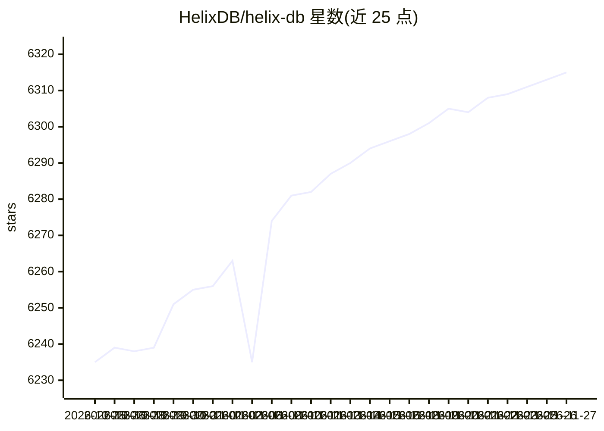

# HelixDB/helix-db

⭐ 6,315 · Rust · Apache-2.0 · 推送 2026-11-26 · [GitHub](https://github.com/HelixDB/helix-db) · [官网](https://helix-db.com) · 组织维护

**面向 AI 应用的内建向量与全文检索的图数据库**

以 Rust 编写、构建于对象存储之上的开源（Apache 2.0）OLTP 图数据库，将实体、关系、向量嵌入与文本放在同一事务引擎中，支持图遍历、近似最近邻向量检索与 BM25 关键词检索的联合查询。通过 Rust/TypeScript/Python/Go 四种语言的 SDK 以 JSON 请求查询本地实例，也提供内嵌模式、自托管服务器与托管云服务三种部署方式。本地实例默认内存存储，可用 --disk 持久化；源码构建还支持 openCypher 读写的兼容层。README 定位的使用场景是 AI 应用的长期记忆与检索（GraphRAG、混合 RAG、知识图谱）。

## 筛选速览

| 维度 | 判定 | 备注 |
|---|---|---|
| AI 角色 | `ai-enhanced` | 去掉 AI 部分产品仍成立 |
| 许可风险 | `permissive` | Apache-2.0 |
| 部署形态 | `library` | 以包/库形式分发 |
| 模型依赖 | — | README 未给出锁定关系 |
| 硬件要求 | — | 无带数字的原话,不猜 |
| 安装摩擦 | `low` | 无编译、无系统依赖或容器化 |
| 成熟度 | — | 结构信号不足 |

## 能力要点

- 图、向量、BM25 全文检索在单一事务引擎中联合查询
- 向量检索可由图遍历预过滤，限定相似度搜索范围
- Rust/TypeScript/Python/Go 四种语言 SDK 与内嵌模式
- helix chef 命令安装查询技能与 docs MCP 并交接给编码 agent

## 适用场景

- 为 agent 搭建长期记忆存储
- 做 GraphRAG 或混合 RAG 的检索后端
- 把文档、人员、工具和决策关联成内部知识图谱
- 替换『图数据库 + 独立向量库』的双存储架构

## 场景标签

`向量数据库` `RAG` `知识图谱` · 领域:知识与检索

## 证据(README 行号)

> L17: HelixDB is an open-source (Apache 2.0) graph database with native vector search and BM25
> L179: Memory and retrieval for AI applications: long-term agent memory, GraphRAG and hybrid RAG, and

## 星数曲线

2026-10-25 6,235 → 2026-11-27 6,315（+80）

---
*卡片 v1 · prompt 1.4 · 生成 2026-11-27 · 置信度 high · 依据 README sha `1ada60552203` · [字段定义](../../DATASET.md)*
