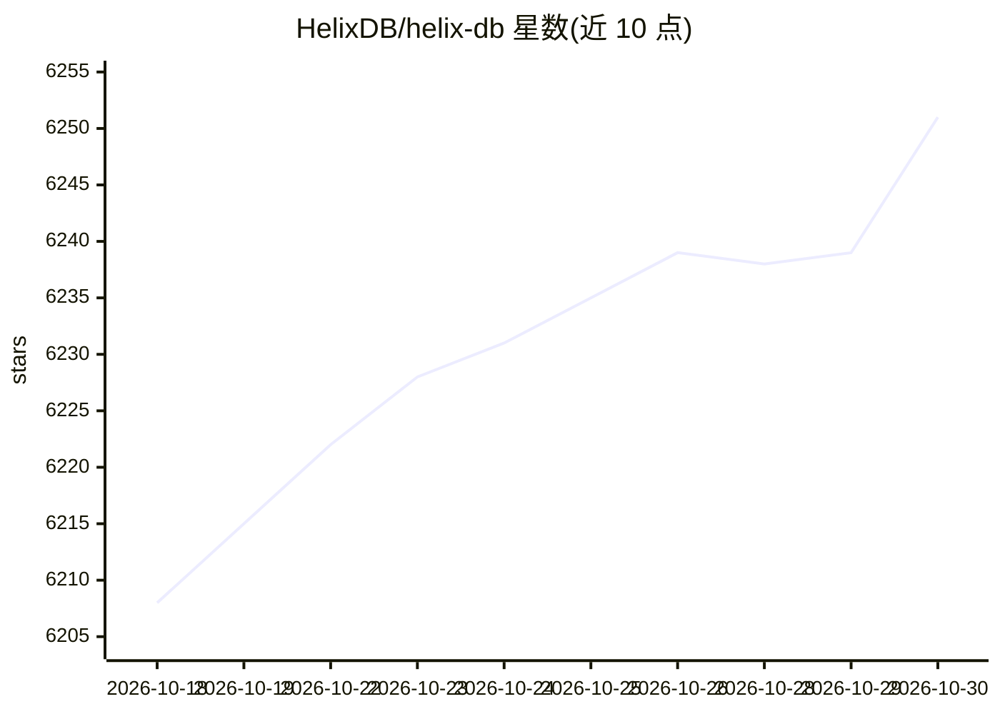

# HelixDB/helix-db

⭐ 6,251 · Rust · Apache-2.0 · 推送 2026-10-29 · [GitHub](https://github.com/HelixDB/helix-db) · [官网](https://helix-db.com) · 组织维护

**Rust 编写的图数据库，内置向量与 BM25 全文检索，面向 AI/RAG 应用**

Apache 2.0 开源图数据库，以标记属性图存储实体、关系、嵌入与文本，在同一事务引擎中提供近似最近邻向量检索（可由图遍历预过滤）与 BM25 全文搜索。以对象存储为持久层，支持嵌入式模式与独立服务器，通过 HTTP 端点查询，提供 Rust、TypeScript、Python、Go 四种 SDK；源码构建另支持 Cypher 读写。另有托管版 Helix Cloud。本地实例启动依赖 Docker 或 Podman，CLI 提供 macOS/Linux 与 Windows 安装脚本。

## 筛选速览

| 维度 | 判定 | 备注 |
|---|---|---|
| AI 角色 | `ai-ecosystem` | LLM/agent 周边工具 |
| 许可风险 | `permissive` | Apache-2.0 |
| 部署形态 | `library` | 以包/库形式分发 |
| 模型依赖 | — | README 未给出锁定关系 |
| 硬件要求 | — | 无带数字的原话,不猜 |
| 安装摩擦 | `low` | 无编译、无系统依赖或容器化 |
| 成熟度 | — | 结构信号不足 |

## 能力要点

- 图、向量、BM25 全文检索统一在单一事务引擎
- 以对象存储为持久层的 Rust 实现，支持嵌入式模式
- Rust/TypeScript/Python/Go 四语言 SDK，同一 JSON 请求格式
- helix chef 命令将项目搭建移交给本机发现的编码 agent（Claude Code/Codex/OpenCode/Cursor）

## 适用场景

- 为 RAG 应用存储嵌入并做图遍历预过滤的向量检索
- 在图中同时建模实体关系与文本属性并统一查询
- 嵌入式模式在自有进程内运行数据库，无需独立服务器

## 场景标签

`向量数据库` `知识图谱` · 领域:知识与检索

## 证据(README 行号)

> L17: HelixDB is an open-source (Apache 2.0) graph database with native vector search and BM25
> L18: full-text search, built in Rust on object storage. Store entities, relationships, embeddings,

## 星数曲线

2026-10-18 6,208 → 2026-10-30 6,251（+43）

---
*卡片 v1 · prompt 1.4 · 生成 2026-10-20 · 置信度 high · 依据 README sha `47462c036222` · [字段定义](../../DATASET.md)*
