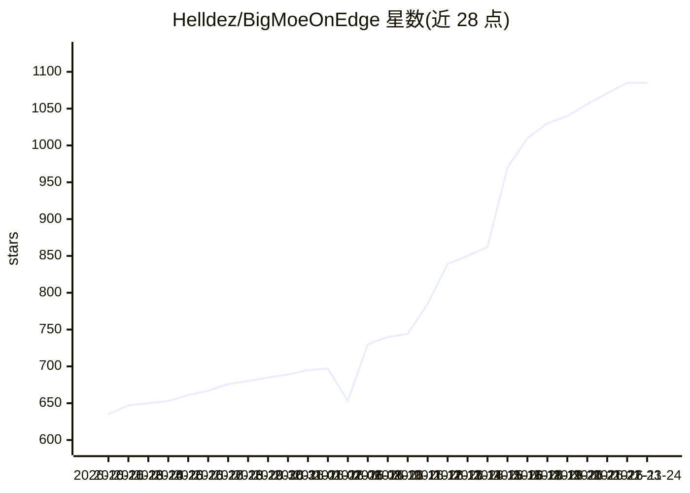

# Helldez/BigMoeOnEdge

⭐ 1,100 · C++ · Apache-2.0 · 推送 2026-11-23 · [GitHub](https://github.com/Helldez/BigMoeOnEdge) · 个人维护

**让手机/笔记本运行超出内存的 MoE 大模型的流式推理引擎**

基于 llama.cpp 公共 API 的 MoE 流式推理引擎：每 token 只保留路由所需权重与高频专家在 VRAM/RAM，其余从闪存按需读取，输出与全量驻留内存一致（有测试校验）。--auto 读取模型头并测量机器的内存、存储与 CPU/GPU/NPU，自动生成放置计划。提供桌面应用、Android/iOS 应用、bmoe-cli，以及 OpenAI 与 Anthropic 兼容的本地服务器（端口 8765，支持流式、工具调用与图像）。面向想在内存受限设备上运行大 MoE GGUF 模型的用户。

## 筛选速览

| 维度 | 判定 | 备注 |
|---|---|---|
| AI 角色 | `ai-ecosystem` | LLM/agent 周边工具 |
| 许可风险 | `permissive` | Apache-2.0 |
| 部署形态 | `desktop` | 安装包/桌面程序 |
| 模型依赖 | local-ok | 支持本地模型 |
| 硬件要求 | — | 无带数字的原话,不猜 |
| 安装摩擦 | `high` | 编译与系统依赖俱全 |
| 成熟度 | — | 结构信号不足 |

## 能力要点

- 专家三级缓存流式读取（VRAM→RAM→Flash），无损运行超内存的 MoE GGUF
- --auto 自动测量机器并生成缓存/线程/设备放置计划
- OpenAI 与 Anthropic 兼容本地服务器，支持流式、工具调用与 mmproj 图像输入
- 桌面/Android/iOS 应用加 CLI，支持 systemd/launchd/Task Scheduler 服务化

## 适用场景

- 在 12 GB 手机或 16 GB 无 GPU 笔记本上本地运行 35B 级 MoE 模型
- 给 opencode、Claude Code、Codex CLI 等编码 agent 提供本地大上下文后端
- 在数据中心 GPU 上以全 GPU 驻留方式高速运行大 MoE 模型

## 场景标签

`推理引擎` · 领域:训练与推理

## 证据(README 行号)

> L10: the model needs them. Android, iOS, macOS, Windows and Linux, built on llama.cpp.
> L41: - **Apps and a server.** A desktop app, phone apps, and an OpenAI- and Anthropic-compatible server
> L110: The server speaks the OpenAI API (`/v1/chat/completions`, `/v1/responses`) and the Anthropic one

## 星数曲线

2026-10-21 635 → 2026-11-24 1,085（+450）

---
*卡片 v1 · prompt 1.4 · 生成 2026-11-24 · 置信度 high · 依据 README sha `64905d11fb17` · [字段定义](../../DATASET.md)*
