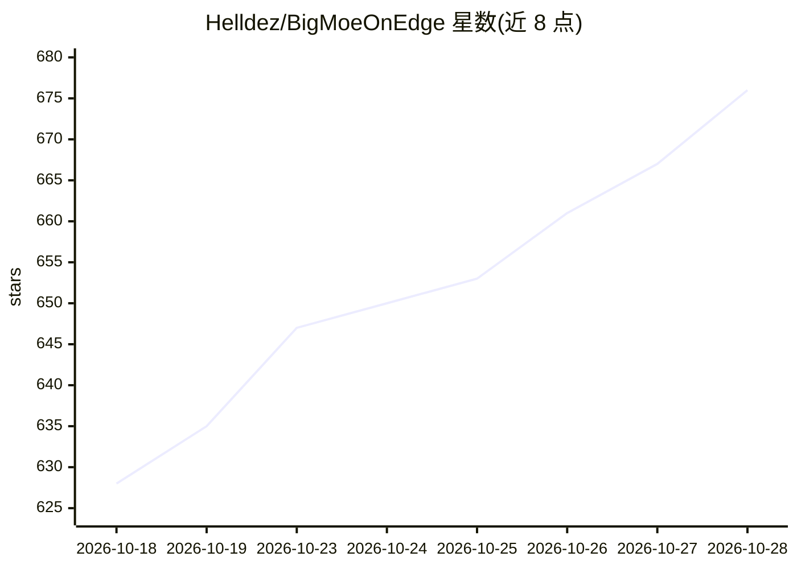

# Helldez/BigMoeOnEdge

⭐ 680 · C++ · Apache-2.0 · 推送 2026-10-28 · [GitHub](https://github.com/Helldez/BigMoeOnEdge) · 个人维护 · 中文 README

**在内存不足的设备上流式运行大 MoE 模型的本地推理引擎**

基于 llama.cpp 公共 API 的 MoE 流式推理引擎：将稠密权重与专家缓存驻留内存，其余专家按需从闪存读取，输出与全内存加载一致（由 ctest 验证）。--auto 规划器测量机器内存/存储/CPU/GPU/NPU 与模型头部后自动分配。支持任意 MoE gguf 与任意量化，后端含 CPU、Metal、Vulkan、OpenCL、Hexagon NPU 等。提供 Android/iOS 原生应用、桌面 Web 应用与各平台 OpenAI 兼容服务器（流式、工具调用、推理支持）。

## 筛选速览

| 维度 | 判定 | 备注 |
|---|---|---|
| AI 角色 | `ai-ecosystem` | LLM/agent 周边工具 |
| 许可风险 | `permissive` | Apache-2.0 |
| 部署形态 | `None` |  |
| 模型依赖 | local-ok | 支持本地模型 |
| 硬件要求 | — | 无带数字的原话,不猜 |
| 安装摩擦 | `medium` | 含编译或系统依赖之一 |
| 成熟度 | `idea` | |

## 能力要点

- 专家张量按需从闪存流式读取，输出与全内存加载一致并有测试验证
- --auto 规划器按机器实测自动设定缓存与设备分工，规则不绑定平台
- 任意 llama.cpp 可加载的 MoE gguf 与任意量化，新架构无需改代码
- 多后端模块（CPU/Metal/Vulkan/OpenCL/Hexagon NPU/CUDA/HIP/SYCL）与各平台 OpenAI 兼容服务器

## 适用场景

- 在 12 GB 手机上运行超过内存大小的 35B–284B MoE 模型
- 把本地大 MoE 模型通过 OpenAI 兼容 API 提供给其他机器或 opencode 等工具
- 在低内存笔记本上不换硬件跑更大的本地模型

## 场景标签

`推理引擎` · 领域:训练与推理

## 证据(README 行号)

> L9: Run Mixture-of-Experts models larger than the device's memory by streaming the experts from flash.
> L10: Built on llama.cpp's public API; Android, iOS, macOS, Windows and Linux; a local OpenAI-compatible
> L103: The engine uses llama.cpp's public API: every quantization, tokenizer and chat template llama.cpp

## 星数曲线

2026-10-18 628 → 2026-10-28 676（+48）

---
*卡片 v1 · prompt 1.4 · 生成 2026-10-22 · 置信度 high · 依据 README sha `e804f14b9ae7` · [字段定义](../../DATASET.md)*
