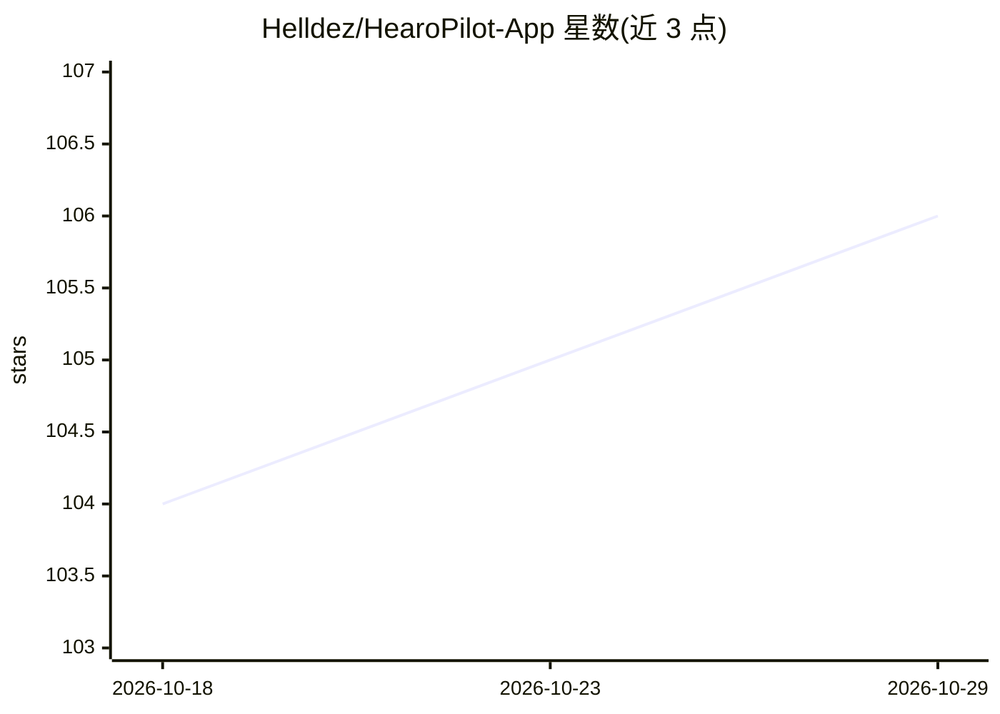

# Helldez/HearoPilot-App

⭐ 106 · Kotlin · Apache-2.0 · 推送 2026-06-10 · [GitHub](https://github.com/Helldez/HearoPilot-App) · 个人维护

**Android 离线会议助手：本机实时转录与 LLM 摘要**

面向 Android 用户的端侧录音与会议辅助应用：以 Sherpa-ONNX 运行 NeMo Parakeet TDT 0.6B Int8 做流式语音转写，以 llama.cpp 运行 Gemma 3 1B（Q8_0/IQ4_NL）或 Qwen 3.5 0.8B（beta，手动下载）生成摘要、任务与建议；录音期间无网络调用。提供 4 种录制模式、25 种 UI 语言、全局搜索、息屏录音与断点续传下载。模型在设备上按 RAM 与 Android 版本自动推荐量化档位，全程录音需约 1.7 GB 存储放两个模型。构建需 Android Studio、JDK 17、NDK r29、CMake 与 Git LFS，llama.cpp 原生层在每次构建时从 C++ 源码编译。

## 筛选速览

| 维度 | 判定 | 备注 |
|---|---|---|
| AI 角色 | `ai-native` | 本体是模型或模型工具 |
| 许可风险 | `permissive` | Apache-2.0 |
| 部署形态 | `None` |  |
| 模型依赖 | local-ok | 支持本地模型 |
| 硬件要求 | — | 无带数字的原话,不猜 |
| 安装摩擦 | `medium` | 含编译或系统依赖之一 |
| 成熟度 | — | 结构信号不足 |

## 能力要点

- 流式 STT（Sherpa-ONNX + NeMo Parakeet TDT 0.6B Int8）与本地 LLM 洞察（llama.cpp + Gemma 3 1B）全程离线
- 4 种录制模式：简单听写、短会、长会、实时翻译
- 按设备 RAM/Android 版本自动推荐 Q8_0 或 IQ4_NL 量化档，模型支持断点续传下载
- 25 种 UI 语言，系统提示词随语言本地化

## 适用场景

- 会议或课堂录音并自动获得摘要、任务与建议
- 在无网络或注重隐私的环境下做实时转录
- 边说边译的实时口语翻译

## 场景标签

`语音识别` · 领域:感知与多模态

## 证据(README 行号)

> L9: HearoPilot combines a local Speech-to-Text engine with a local Large Language Model to deliver
> L15: - **Real-time transcription** — streaming STT via Sherpa-ONNX (NeMo Parakeet TDT 0.6B Int8)
> L16: - **On-device AI insights** — contextual analysis via llama.cpp (Gemma 3 1B, Q8_0 / IQ4_NL)

## 星数曲线

2026-10-18 104 → 2026-10-29 106（+2）

---
*卡片 v1 · prompt 1.4 · 生成 2026-10-23 · 置信度 high · 依据 README sha `f4a4736c85a9` · [字段定义](../../DATASET.md)*
